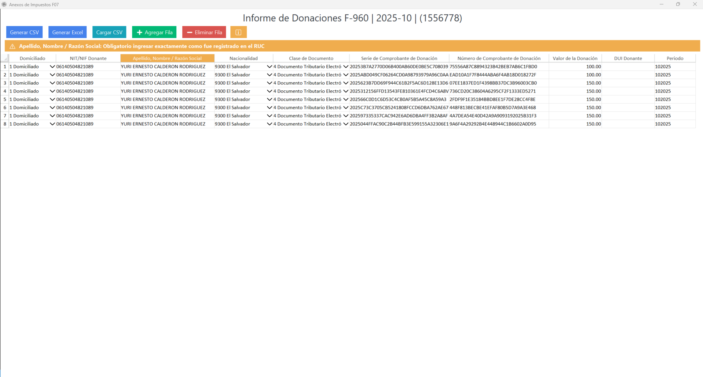

# **Informe de Donaciones F-960**

El módulo de **Informe de Donaciones F-960** te permite consolidar, revisar, editar y exportar la información de comprobantes de donación (DTE tipo **15**) y documentos físicos de donación requeridos por el **Ministerio de Hacienda**.

---

## **Cómo Acceder al Informe F-960**

1. Abre tu empresa en el **Lector JSON**.
2. Selecciona el **Año** y **Mes** del periodo tributario que deseas declarar.
3. Haz clic en el botón **Anexos** en la barra superior y elige **Informe de Donaciones F-960**.

---

## **Editor Interactivo y Validaciones Normativas**

Al abrir el módulo, PyConta carga automáticamente los Comprobantes de Donación (tipo **15**) del periodo seleccionado junto con las herramientas de edición tabular:

{ align=center }

### Reglas y Ayudas Integradas en el Editor:
- **Nota de Advertencia Obligatoria sobre el Donante**: La cabecera de la columna de **Apellido, Nombre / Razón Social** aparece resaltada visualmente acompañada de un aviso permanente recordando que el nombre o razón social del donante debe ingresarse exactamente como figura registrado en el **RUC**.
- **Pre-relleno Automático de Periodo**: Al cargar registros o agregar nuevas filas, la columna de periodo se completa automáticamente en formato `MMAAAA` según el mes y año activos.
- **Valores Predeterminados para Documentos Físicos**: Al presionar **Agregar Fila** para registrar un documento físico en papel, el sistema preasigna automáticamente el estado de domicilio, código de país (`9300 El Salvador`) y clase de documento físico para agilizar la captura.
- **Validación Normativa según Vigencia del Periodo**:
  - **Uso de DUI como identificación**: Aceptado automáticamente para periodos a partir de **enero de 2022**.
  - **Código de Generación vs. Número de Control**: Validación adaptada automáticamente para periodos a partir de **noviembre de 2022**.

---

## **Exportación de Archivos**

Al igual que en los Anexos F07, puedes validar y generar los archivos finales desde la barra superior del editor:

- **Generar CSV**: Crea el archivo delimitado con la estructura oficial requerida para su presentación ante el Ministerio de Hacienda.
- **Generar Excel**: Exporta la tabla de donaciones a formato `.xlsx` para control interno y auditoría.
- **Cargar CSV**: Permite importar un archivo CSV existente para continuar su revisión o edición.

---

## **Criterios de Verificación**
- El nombre o razón social de cada donante coincide exactamente con su registro en el RUC.
- El formato del periodo (`MMAAAA`) y los documentos de identificación (NIT, NIF o DUI según vigencia) pasan la validación sin errores antes de exportar el CSV.
- Los comprobantes de donación electrónicos (DTE 15) y los documentos físicos agregados manualmente reflejan los montos correctos.

---

## **Enlaces Relacionados**
- [Anexos de Impuestos F07](anexos-de-impuestos-f07.md)
- [Lector JSON](lector-json.md)
- [Generación de Libros de IVA](libros-iva.md)
