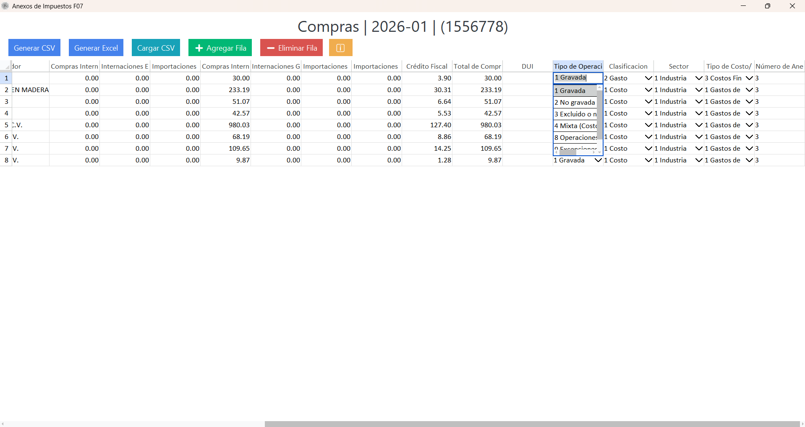
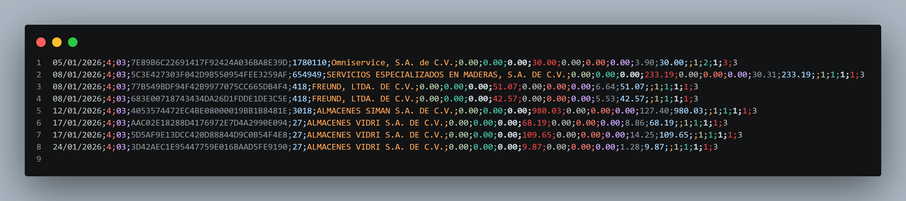
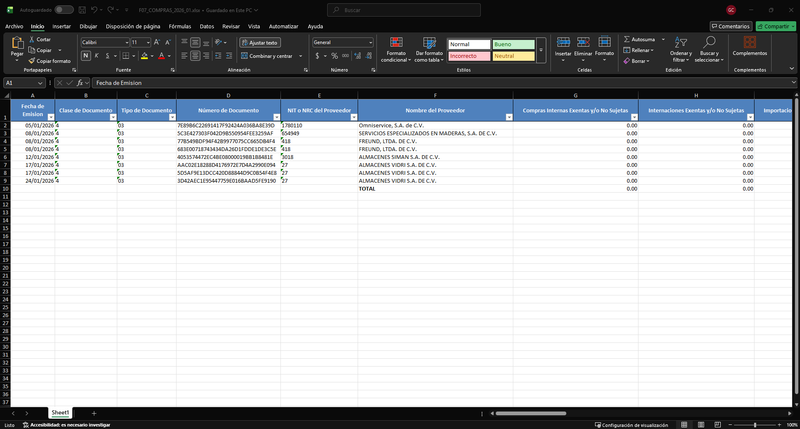
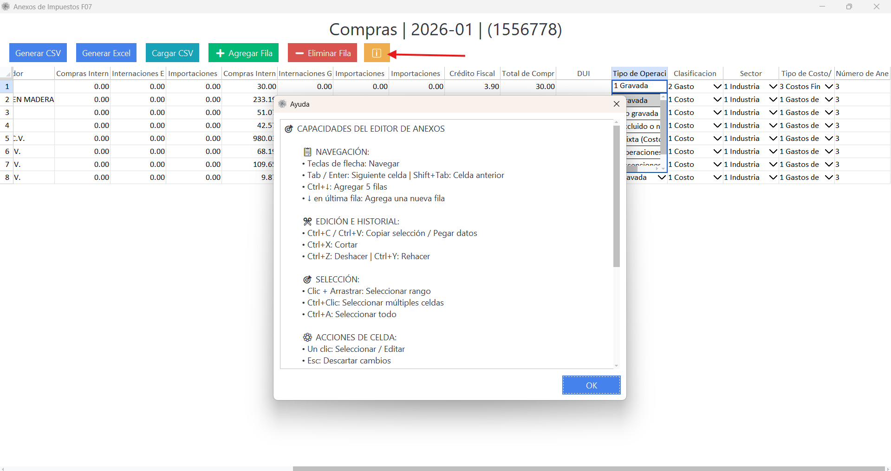

# **Anexos de Impuestos F07**

El módulo de **Anexos de Impuestos F07** te permite preparar, revisar, editar y validar la información tributaria requerida para la declaración mensual de impuestos (F07) ante el **Ministerio de Hacienda**, a través de una tabla interactiva con capacidades similares a una hoja de cálculo.

---

## **Editor Interactivo de Anexos**

La pantalla principal consolida automáticamente las compras y ventas del periodo seleccionado, permitiendo revisar y ajustar cada registro:

{ align=center }

---

## **Funcionalidades del Editor**

### 1. Validación en Bloque antes de Exportar
Antes de generar los archivos finales, PyConta realiza una verificación automática de coherencia:
- Validación de formatos de NIT y DUI.
- Comprobación de números de control y resoluciones.
- Detección de filas vacías o campos obligatorios incompletos.
- Notificación preventiva con resumen de inconsistencias para que puedas corregirlas a tiempo.

---

### 2. Generar CSV Oficial para Hacienda
Genera el archivo en formato texto delimitado (CSV) con la estructura y codificación exacta exigida por el portal de declaraciones del Ministerio de Hacienda.

{ align=center }

---

### 3. Generar Excel de Auditoría
Exporta la cuadrícula de datos directamente a un archivo de Excel (`.xlsx`) para revisiones internas, conciliaciones o archivo contable.

{ align=center }

---

### 4. Cargar CSV Externo
Permite importar un archivo CSV previo para continuar con una edición o consolidar datos generados externamente.

---

### 5. Agregar y Eliminar Filas
Si tu empresa cuenta con facturas o créditos fiscales tradicionales en papel emitidos o recibidos durante el mes:
- Utiliza **Agregar Fila** para digitar manualmente los datos del documento físico para la declaración F07 (ten en cuenta que estos registros manuales no se agregan a los Libros de IVA).
- Utiliza **Eliminar Fila** para retirar cualquier registro que no deba incluirse en el periodo.

---

## **Atajos y Ayuda del Editor**

El botón de **Ayuda** en la barra superior resume los atajos de teclado para desplazamiento rápido, selección múltiple, copiado de celdas y confirmación de cambios en la cuadrícula:

{ align=center }

---

## **Criterios de Verificación**
- Los totales del anexo coinciden con los libros de IVA del mismo periodo.
- El archivo CSV se genera sin errores de formato para su carga exitosa en Hacienda.
- Las notas de crédito y DTEs de personas naturales con DUI se encuentran correctamente reflejados.

---

## **Enlaces Relacionados**
- [Lector JSON](lector-json.md)
- [Generación de Libros de IVA](libros-iva.md)
