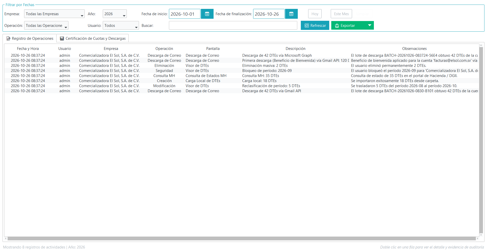
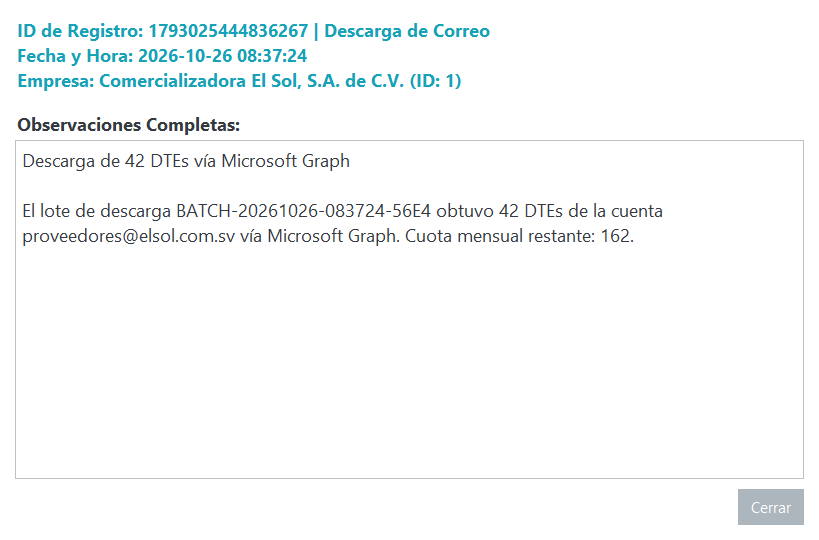
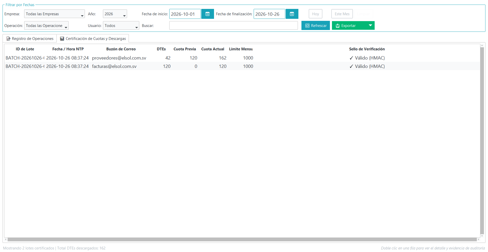
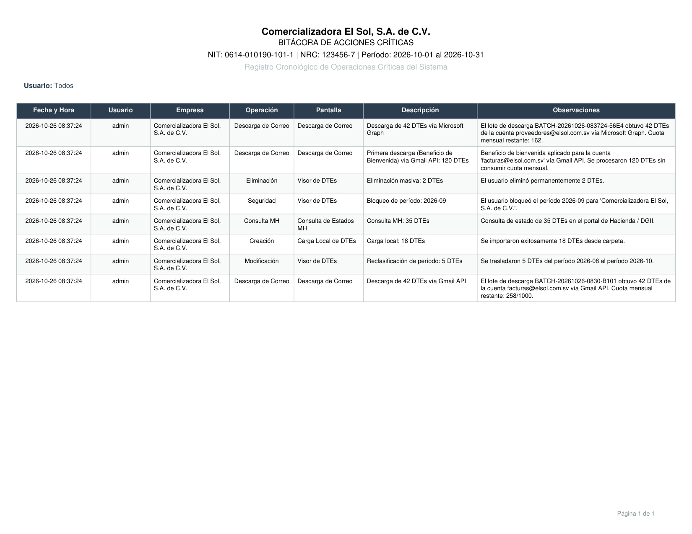

# **Bitácora de Actividades y Auditoría**

El módulo de **Bitácora de Actividades** de PyConta es un sistema centralizado de auditoría y trazabilidad operativa que registra automáticamente todos los eventos críticos ejecutados sobre la información contable y tributaria de tu empresa.

Proporciona un registro seguro, confiable y estructurado para garantizar la seguridad de la información, el control de procesos internos y el cumplimiento normativo ante auditorías o revisiones del **Ministerio de Hacienda**.

---

## **¿Por qué es importante la Bitácora de Actividades?**

En la gestión tributaria electrónica, contar con un registro detallado de las operaciones es indispensable para:

- **Trazabilidad y Control Interno**: Conocer con exactitud qué usuario ejecutó una operación, en qué fecha y hora, y qué registros resultaron afectados.
- **Soporte ante Auditorías Fiscales**: Demostrar la fecha y resultado de consultas oficiales, traslados de compras y recepciones de DTEs ante requerimientos de la Administración Tributaria.
- **Certificación de Cuotas de Consulta**: Respaldar con certeza el conteo de consultas realizadas ante el Ministerio de Hacienda mediante sellos digitales de seguridad.
- **Detección de Incidencias**: Localizar rápidamente fallas de conexión a internet, intermitencias del servidor tributario o errores en sincronizaciones masivas.

---

## **Eventos Auditados por el Sistema**

PyConta registra en segundo plano y de forma automática eventos clave clasificados por categoría:

| Tipo de Evento | Descripción Operativa | Evidencia Registrada |
| :--- | :--- | :--- |
| **Consulta Masiva MH** | Verificación masiva de estados de DTEs ante el servicio de consulta de Hacienda. | Cantidad procesada, aprobados, rechazados, invalidados y tiempo de ejecución. |
| **Consulta Individual** | Consulta tributaria puntual de un DTE específico. | Código de generación, sello de recepción obtenido y estado retornado. |
| **Descarga desde Correo** | Procesamiento automático de bandejas de entrada vinculadas. | Correos analizados, DTEs extraídos válidos, enlaces analizados y descartes. |
| **Sincronización Local** | Lectura y validación de carpetas de almacenamiento local. | Documentos nuevos agregados, duplicados omitidos y errores de formato. |
| **Traslado de Compras** | Reasignación de DTEs de crédito fiscal a periodos posteriores (3 meses). | DTEs trasladados, periodo de origen y periodo de destino. |
| **Importación JSON / Lote** | Carga directa de archivos tributarios JSON al sistema. | Archivos leídos, validados con éxito o rechazados con advertencia. |

---

## **Exploración de la Bitácora (Timeline Operativo)**

Al acceder a la **Bitácora de Actividades** desde el menú principal de la empresa, el sistema despliega una línea de tiempo cronológica con todas las operaciones registradas:

{ align=center }

### Funcionalidades del Explorador:

1. **Filtrado por Periodo y Rango de Fechas**: Permite delimitar la visualización a días específicos, semanas o el mes contable en curso.
2. **Filtrado por Módulo o Acción**: Filtra eventos específicos como descargas de correo, consultas MH o traslados.
3. **Indicadores de Estado Visual**: Los eventos se identifican con íconos de éxito, advertencia o error según su resultado de ejecución.
4. **Búsqueda Rápida**: Encuentra transacciones por código de generación, identificador de lote o usuario responsable.

---

## **Inspección de Evidencia Técnica**

Cada entrada de la bitácora almacena el detalle completo de la operación. Al seleccionar un registro y presionar **Inspeccionar Detalle** (o hacer doble clic en la fila), se abre el diálogo de detalle técnico:

{ align=center }

### Contenido de la Evidencia:
- **Resumen Ejecutivo**: Fecha y hora exacta (marca de tiempo ISO), usuario de sesión, módulo y acción realizada.
- **Parámetros y Detalles**: Resultado del evento, observaciones del proceso y parámetros asociados a la operación.

---

## **Certificación y Registro de Cuotas**

El Ministerio de Hacienda establece límites y cuotas operativas para el consumo de sus servicios de consulta electrónica. Para garantizar que cada consulta quede formalmente certificada y no existan discrepancias en el conteo de peticiones, PyConta incorpora la pestaña **Certificación de Cuotas y Descargas**:

{ align=center }

### ¿Cómo funciona la Certificación y Registro de Cuotas?

1. **Registro Inalterable**: Cada bloque de consultas descuenta y certifica de forma automática las peticiones utilizadas.
2. **Sello Digital de Seguridad**: Cada entrada del registro genera un código de seguridad único que encadena la transacción anterior con la actual, impidiendo cualquier alteración manual en la base de datos local.
3. **Control de Balance**: Muestra en tiempo real el saldo de cuota disponible, la cantidad consumida en la sesión y el acumulado mensual por empresa.

---

## **Generación de Reportes de Auditoría en PDF**

Para fines de cumplimiento, entrega a gerencia o respuesta a requerimientos de auditoría externa, puedes exportar la bitácora completa en un informe ejecutivo formal en formato PDF:

1. Dentro de la Bitácora de Actividades, presiona el botón **Generar Reporte PDF** :material-file-pdf-box:.
2. Elige el rango de fechas y los tipos de eventos que deseas incluir en el informe.
3. PyConta compilará el documento estructurado con membrete corporativo, resumen estadístico y la tabla detallada de operaciones:

{ align=center }

### Estructura del Informe PDF:
- **Encabezado y Metadatos**: Nombre de la empresa, NIT, periodo auditado, usuario que emite el reporte y fecha de expedición.
- **Resumen Estadístico**: Total de operaciones, tasa de éxito, volumen de DTEs consultados y cuota MH consumida.
- **Detalle Cronológico**: Tabla paginada con fecha, hora, módulo, usuario, observaciones y estado de cada evento.

---

## **Enlaces Relacionados**
- [Consulta en Hacienda](consulta-hacienda.md)
- [Descarga Desde Correo](descarga-desde-correo.md)
- [Lector JSON](lector-json.md)
- [Parámetros de Validación](parametros-validacion.md)

