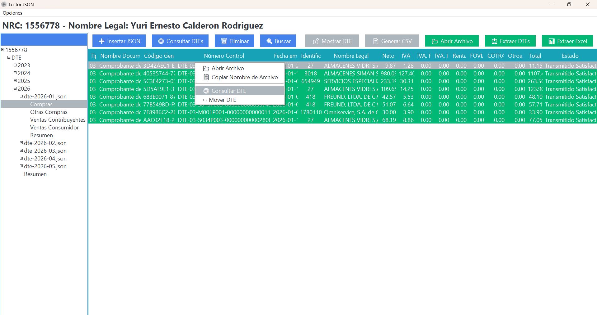
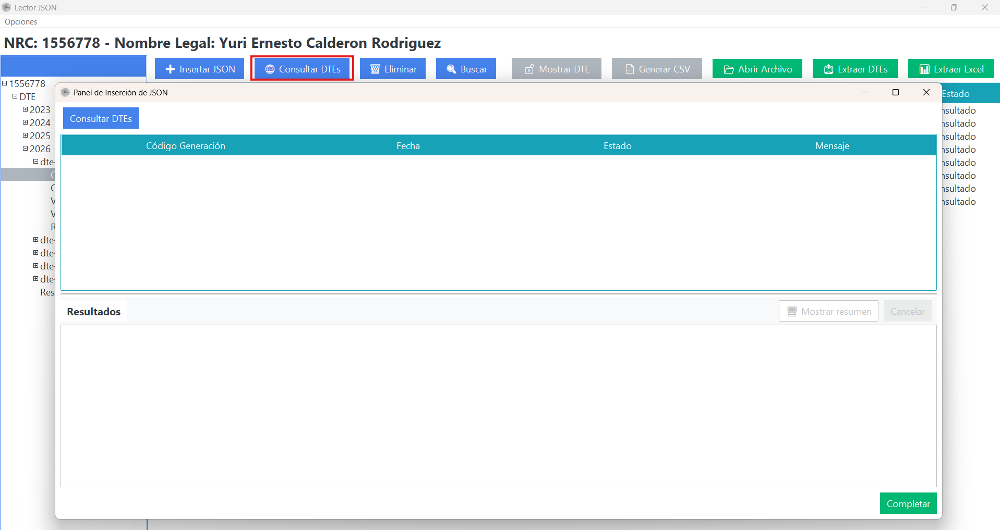
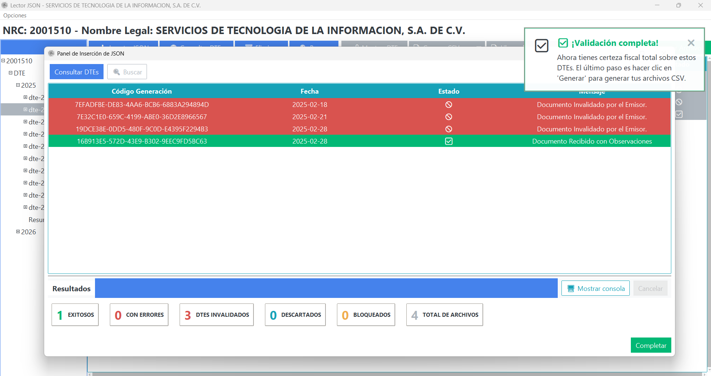
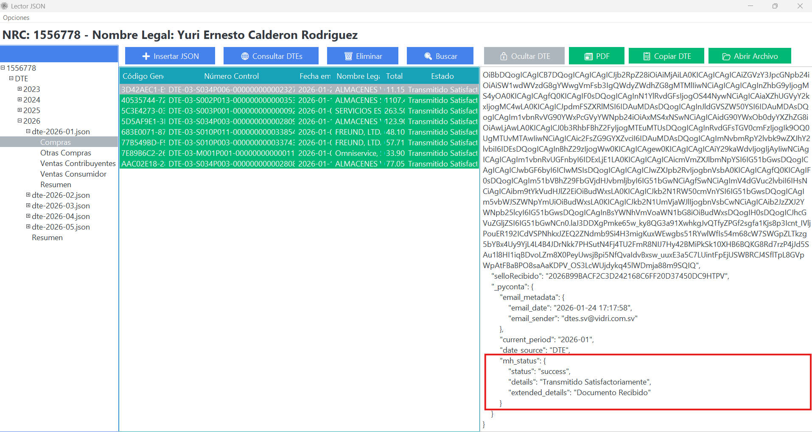

# **Consulta en Hacienda**

PyConta te permite verificar en tiempo real el estado tributario oficial de tus DTEs directamente contra el servicio de consulta del **Ministerio de Hacienda**, asegurando la validez fiscal y la trazabilidad de tus operaciones.

---

## **Beneficios de la Consulta Oficial**

Al consultar tus DTEs ante el Ministerio de Hacienda, obtienes:

- **Validación de Estado Oficial**: Confirmación de si el documento está *Aceptado*, *Rechazado*, *Invalidado* o *Ajustado*.
- **Recuperación de Sello de Recepción**: Si recibiste un DTE en contingencia o sin sello visible, la consulta oficial lo recupera e incorpora automáticamente al documento.
- **Detección de Observaciones**: Registro de cualquier observación o mensaje emitido por la autoridad tributaria.
- **Protección de Datos**: Los documentos consultados conservan su trazabilidad oficial y quedan protegidos contra sobreescrituras accidentales en futuras importaciones.

---

## **Modalidades de Consulta en PyConta**

### 1. Consulta Individual
Ideal para validar un documento puntual desde el menú contextual o las acciones del listado:

1. Haz clic derecho sobre el DTE en la tabla.
2. Selecciona la opción **Consultar DTE en Hacienda** (o **Consultar DTE**).
3. El sistema consultará el estado y actualizará los datos del DTE al instante.

{ align=center }

---

### 2. Consulta Masiva Inteligente por Categoría
Permite validar todos los DTEs de un periodo (Compras o Ventas) en un solo proceso:

1. Selecciona la categoría del periodo en el árbol lateral.
2. Presiona el botón de **Consulta Masiva en Hacienda**.
3. **Optimización Inteligente**: El sistema detecta y omite automáticamente los documentos que ya fueron validados previamente, consultando únicamente los DTEs nuevos o pendientes. Esto agiliza el proceso y optimiza el uso de la conexión.

{ align=center }

Al finalizar el proceso, se presenta un panel detallado con el resumen de estados:

{ align=center }

---

### 3. Consulta de Filas Seleccionadas
Si deseas consultar únicamente un subconjunto de DTEs, marca las filas correspondientes en la tabla, haz clic derecho y selecciona consultar los elementos seleccionados.

---

## **Trazabilidad y Resguardo del Estado Oficial**

Una vez realizada la consulta, la información devuelta por el Ministerio de Hacienda (fecha de consulta, estado tributario, sello oficial y observaciones) queda vinculada al DTE:

- Se refleja en la columna de estado del listado.
- Queda integrada en la vista PDF y JSON del documento.
- Los documentos validados quedan protegidos para evitar reprocesamientos innecesarios al sincronizar nuevamente.

{ align=center }

---

## **Enlaces Relacionados**
- [Lector JSON](lector-json.md)
- [Solución a Problemas: DTE Sin Sello](../problemas-comunes/dte-sin-sello.md)
- [Solución a Problemas: DTE No Aparece](../problemas-comunes/dte-no-aparece.md)
