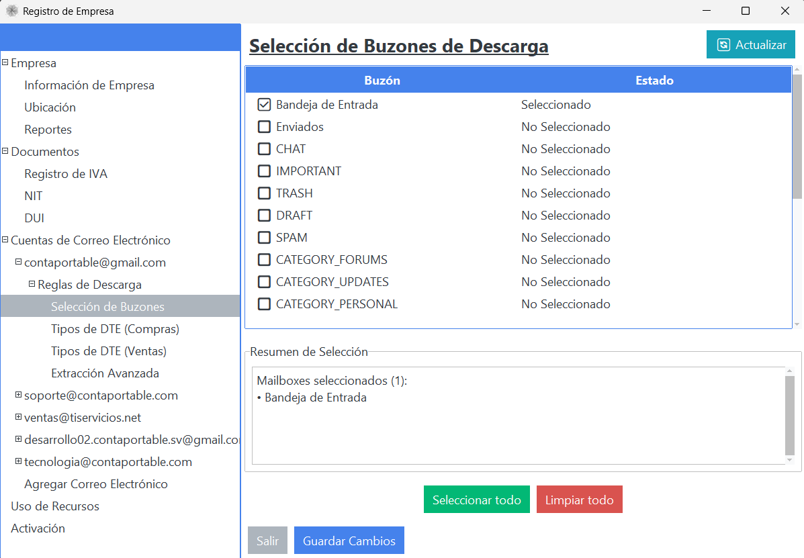
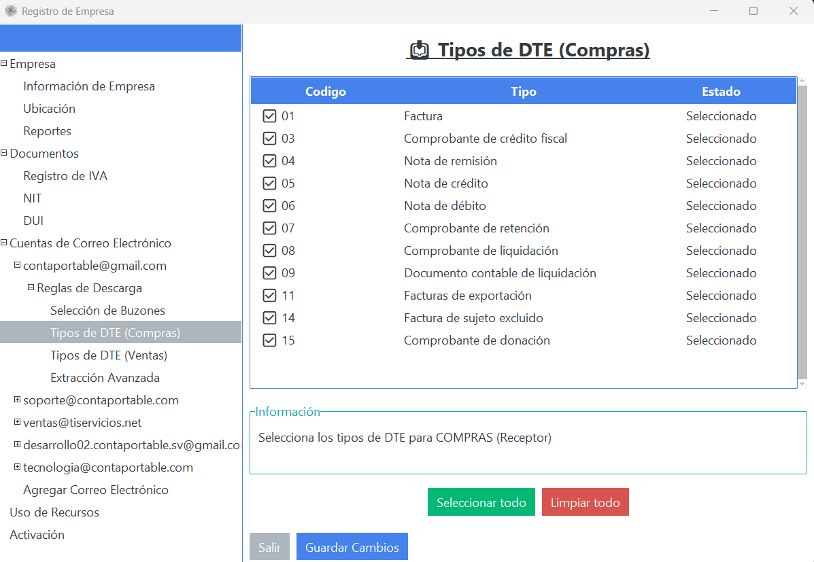
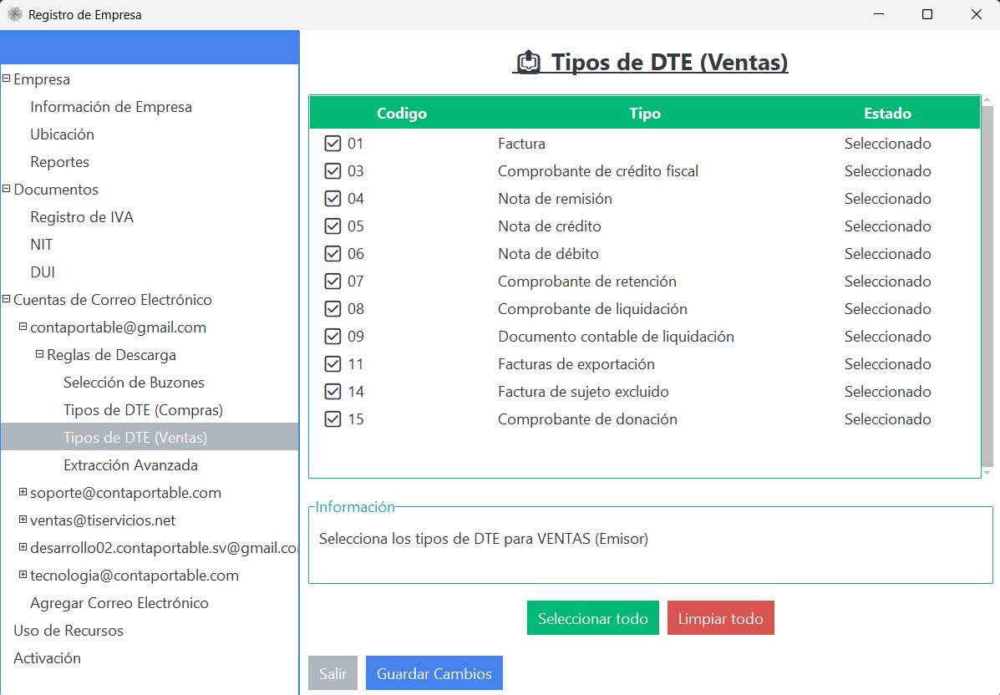
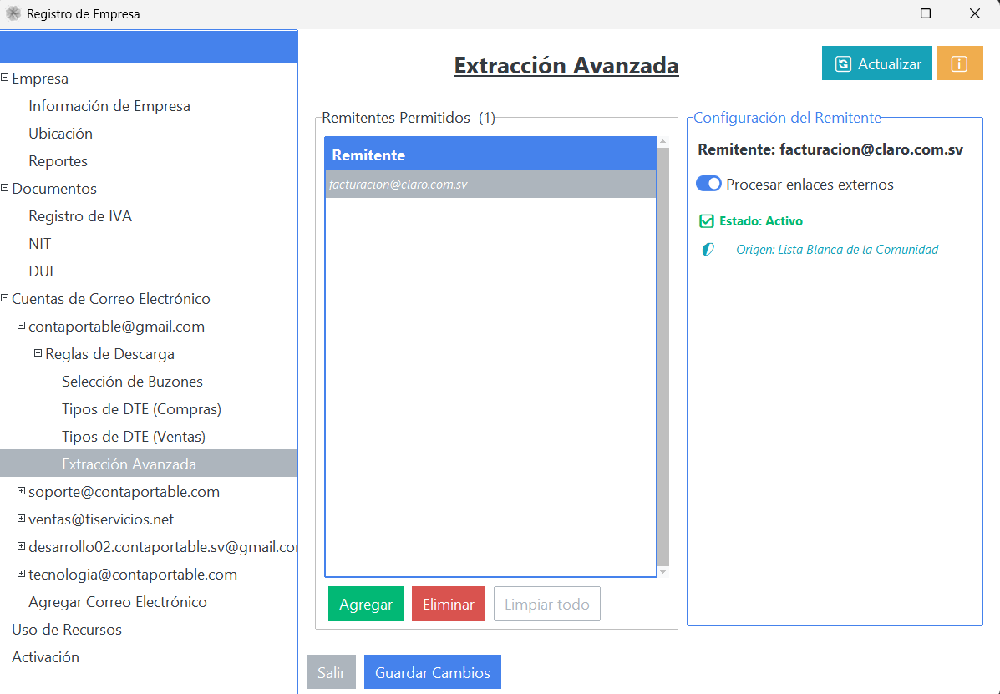
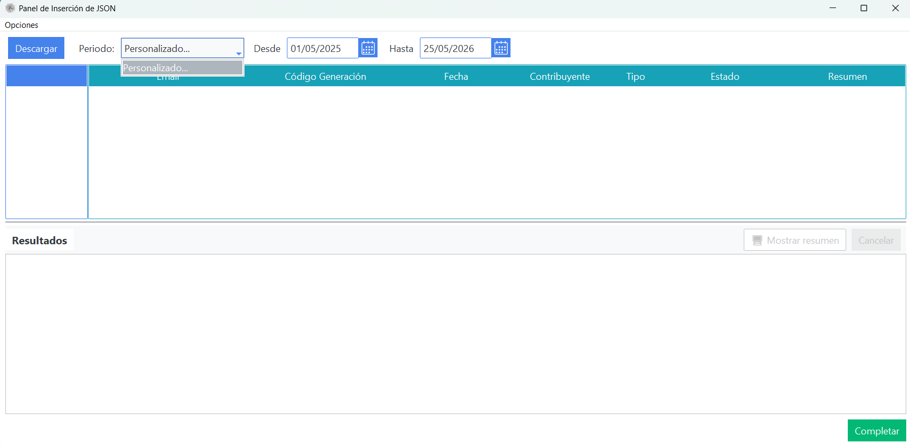
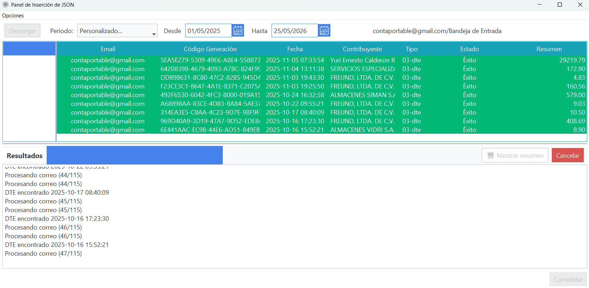
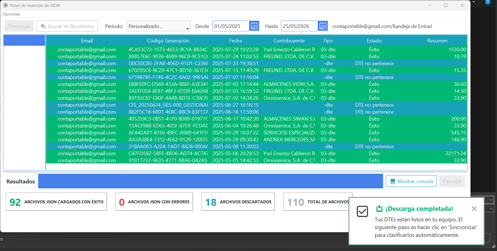

# **Descarga Desde Correo**

PyConta automatiza la captura y lectura de DTEs directamente desde tus cuentas de correo conectadas (Gmail, Microsoft Outlook / 365 y servidores IMAP), incluyendo la extracción de adjuntos y la descarga inteligente de DTEs alojados en enlaces externos.

---

## **Flujo de Descarga de DTEs**

### 1. Selección de Cuentas y Buzones Autorizados
En la configuración de la empresa, dentro de las reglas de descarga de cada cuenta, puedes definir qué carpetas estarán habilitadas para la lectura:

{ align=center }

!!! info "Acceso a Bandejas"
    En el **Plan Demo**, la descarga está limitada a la **Bandeja de Entrada** y **Bandeja de Enviados**. En los **Planes Premium** puedes configurar cualquier carpeta o etiqueta adicional de tu correo.

---

### 2. Configuración de Tipos de DTE (Compras y Ventas)
Puedes personalizar qué tipos de DTEs deben procesarse según el rol de la cuenta de correo vinculada:

=== "Compras (Receptor)"
    Permite capturar Facturas Electrónicas, Comprobantes de Crédito Fiscal, Notas de Crédito, Facturas de Sujeto Excluido y demás DTEs recibidos de proveedores.

    { align=center }

=== "Ventas (Emisor)"
    Permite registrar los DTEs emitidos por tu propia empresa para consolidar automáticamente el Libro de Ventas a Contribuyente y Consumidor Final.

    { align=center }

---

### 3. Extracción Avanzada
El módulo de **Extracción Avanzada** permite establecer reglas de procesamiento especializadas para remitentes específicos, adaptando la captura de DTEs a los diferentes métodos de entrega utilizados por los emisores.

{ align=center }

#### Gestión de Remitentes:
- **Lista Blanca de la Comunidad**: Conjunto de reglas optimizadas y mantenidas para emisores frecuentes de servicios. Puedes usar el botón **Actualizar** para sincronizar nuevas incorporaciones comunitarias.
- **Remitentes Manuales**: Posibilidad de registrar cualquier dirección de correo emisora mediante el botón **Agregar** para aplicarle reglas personalizadas.

#### Reglas de Procesamiento Disponibles:
- **Procesar Enlaces Externos**: Diseñada para proveedores que no adjuntan directamente los archivos en el mensaje, sino que proporcionan enlaces o botones de descarga web (incluyendo portales de facturación y servicios de almacenamiento en la nube). Al activarse, PyConta inspecciona los enlaces del correo y realiza:
    - **Descarga de DTEs directos**: Recupera automáticamente los archivos `.json` y sus representaciones en `.pdf`, emparejándolos de forma consistente.
    - **Descompresión desde enlaces**: Si el enlace apunta a un archivo comprimido (`.zip`, `.rar`, `.7z`), el sistema descarga el paquete y extrae automáticamente los DTEs contenidos.

---

### 4. Selección del Periodo de Descarga Inteligente
Al abrir el panel de descarga, PyConta analiza el historial de la cuenta y ofrece diferentes rangos temporales:

1. **Último Mes Descargado**: Modo inteligente recomendado que detecta automáticamente el último periodo pendiente de procesar.
2. **Mes Anterior**: Descarga el mes fiscal inmediatamente anterior.
3. **Últimos 3 Meses**: Rango amplio para consolidaciones trimestrales.
4. **Personalizado**: Permite seleccionar libremente una fecha de inicio y fin.

{ align=center }

!!! tip "Descarga Inicial Inteligente"
    En la primera descarga de una cuenta nueva, el sistema propone automáticamente un rango de **1 año** en modo Personalizado para construir tu historial base. En las siguientes ocasiones, sugerirá de forma automática el periodo pendiente más reciente.

---

### 5. Descarga y Monitoreo en Tiempo Real
Al iniciar el proceso, la ventana muestra el avance en tiempo real:

- Conexión segura con el servidor de correo.
- Detección de adjuntos directos y descompresión automática de paquetes comprimidos (`.zip`, `.rar`, `.7z`).
- Extracción de DTEs directos y descompresión de paquetes desde enlaces web para remitentes con reglas avanzadas activas.
- Emparejamiento del archivo `.json` con su respectiva representación en `.pdf`.
- Validación de firmas y sellos fiscales.

{ align=center }

---

### 6. Resumen de Resultados
Al concluir la descarga, se presenta una pantalla de resumen con el desglose de documentos procesados con éxito, omitidos por duplicidad y el total general:

{ align=center }

!!! tip "Búsqueda Rápida en el Resumen"
    Puedes utilizar el atajo de teclado **Ctrl + F** (en Windows) o **Cmd + F** (en macOS) para buscar proveedores, números de control o montos directamente en la lista de resultados.

!!! tip "Menú de Acciones y Visor de DTE"
    Al hacer clic derecho sobre cualquier fila de la lista de resultados, puedes acceder a opciones directas para copiar el nombre, el estado o inspeccionar el documento en el [Visor de DTE](visor-dte.md).

---

## **Enlaces Relacionados**
- [Sincronización de DTEs](sincronizacion.md)
- [Gestión en el Lector JSON](lector-json.md)
- [Solución a Problemas: No Descarga Correos](../problemas-comunes/no-descarga-correos.md)
- [Buenas Prácticas Operativas](../informacion-importante/buenas-practicas-operativas.md)
