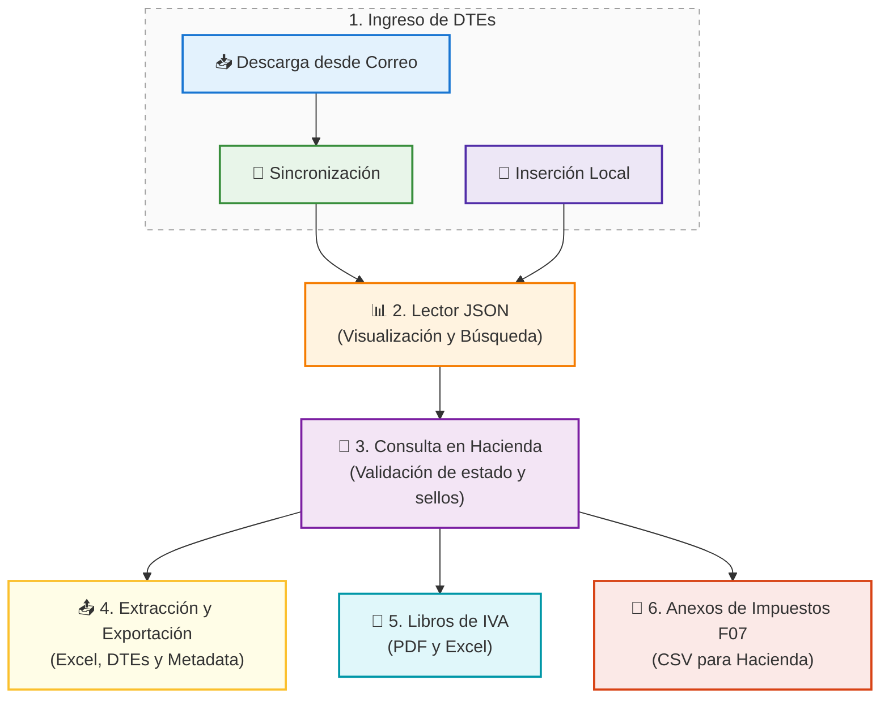

# **Flujo Completo de Gestión de DTEs**

PyConta centraliza la captura, validación, exportación y generación de libros y declaraciones de impuestos a partir de tus DTEs.

---

## **Diagrama del Ciclo de Vida del DTE**

---

## **Etapas del Flujo de Trabajo**

### 1. Ingreso de DTEs
- **[Descarga Desde Correo](descarga-desde-correo.md)** y **[Sincronización](sincronizacion.md)**: Extrae DTEs de tus buzones y los clasifica automáticamente por periodo y categoría.
- **[Inserción Local](importacion-json.md)**: Carga manual de archivos o carpetas `.json` desde tu equipo.

### 2. Exploración en Lector JSON
- **[Lector JSON](lector-json.md)**: Visualización dual (PDF y JSON), búsqueda rápida por cualquier dato de la tabla, reclasificación de periodos y resumen financiero.

### 3. Validación ante Hacienda
- **[Consulta en Hacienda](consulta-hacienda.md)**: Verifica estados oficiales (Aceptado, Rechazado, Invalidado) y recupera sellos de recepción directamente del servicio de consulta del Ministerio de Hacienda.

### 4. Extracción y Exportación
- **Excel y DTEs**: Exporta listados consolidados en `.xlsx` o empaqueta los archivos `.json` originales.
- **Exportar Metadata**: Genera resúmenes estructurados por año o mes para análisis contable o integración con IA.

### 5. Salidas Fiscales
- **[Libros de IVA](libros-iva.md)**: Emisión de libros de Consumidor, Compras y Contribuyente en PDF y Excel.
- **[Anexos de Impuestos F07](anexos-de-impuestos-f07.md)**: Edición en tabla y generación del archivo CSV para el Ministerio de Hacienda.
