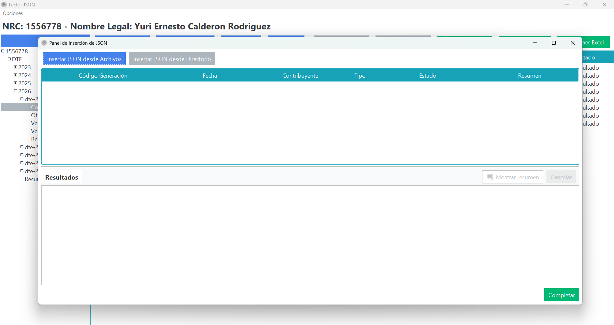
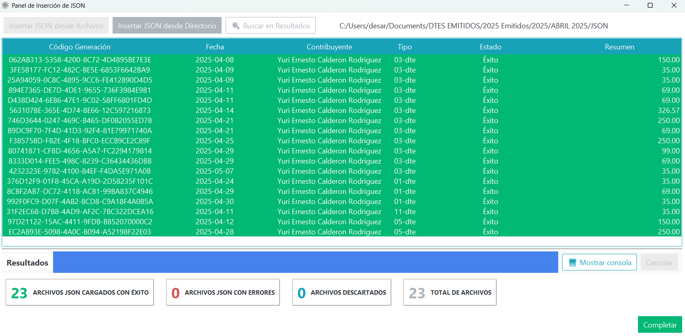

# **Inserción Local de JSON**

La inserción local permite cargar DTEs directamente desde los archivos o carpetas de tu computadora hacia la base de datos de PyConta, sin requerir conexión a buzones de correo.

---

## **Opciones de Inserción Local**

PyConta ofrece dos modalidades para cargar archivos locales:

- **Insertar JSON desde Archivos**: Permite seleccionar manualmente uno o varios archivos `.json` específicos.
- **Insertar JSON desde Directorio**: Permite seleccionar una carpeta completa, realizando una búsqueda recursiva automática en todos sus subdirectorios.

---

## **Flujo de Inserción Paso a Paso**

### 1. Panel de Inserción Local
Desde la pantalla de carga, selecciona la modalidad deseada (por archivos o directorio) para iniciar el procesamiento:

{ align=center }

---

### 2. Resultados de la Inserción
Al completar la lectura, la ventana presenta el consolidado de documentos procesados con éxito, descartados o con observaciones:

{ align=center }

---

!!! tip "Menú de Acciones y Visor de DTE"
    Al hacer clic derecho sobre cualquier fila en la tabla de resultados, puedes acceder a opciones directas para copiar el nombre, el estado o inspeccionar el contenido completo del documento en el [Visor de DTE](visor-dte.md).

---

## **Recomendaciones Operativas**
- Utiliza **Insertar JSON desde Directorio** para cargas históricas o migraciones masivas.
- Utiliza **Insertar JSON desde Archivos** para reingresos puntuales o corrección de documentos específicos.
- Tras la inserción, los documentos quedan clasificados automáticamente en el **Lector JSON**.

---

## **Enlaces Relacionados**
- [Lector JSON](lector-json.md)
- [Descarga Desde Correo](descarga-desde-correo.md)
- [Sincronización de DTEs](sincronizacion.md)
