# **Lector JSON y Visor de DTEs**

El **Lector JSON** es el centro de control operativo de PyConta. Desde este panel puedes explorar, visualizar, validar, reclasificar y exportar todos los DTEs procesados en tu empresa.

---

## **Estructura y Navegación del Panel**

### 1. Árbol Lateral de Periodos y Categorías
El panel izquierdo organiza automáticamente tus documentos por **Año**, **Mes** y **Categorías fiscales**:

- **Compras**: Comprobantes de Crédito Fiscal, facturas de sujeto excluido y facturas recibidas de proveedores.
- **Otras Compras**: Compras no sujetas, gastos específicos o clasificaciones especiales.
- **Ventas Contribuyentes**: Comprobantes de Crédito Fiscal emitidos a otros contribuyentes.
- **Ventas Consumidor**: Facturas emitidas a consumidores finales.
- **Invalidadas**: Aloja los eventos de invalidación oficiales generados o recibidos.
- **Retornadas**: Aloja los eventos de retorno oficiales, los cuales representan una disminución total o parcial en los documentos permisibles (con efecto similar a las notas de crédito, aplicable a DTEs tipo **01** - Factura Electrónica, **11** - Factura de Exportación [FEX] y **14** - Factura de Sujeto Excluido).

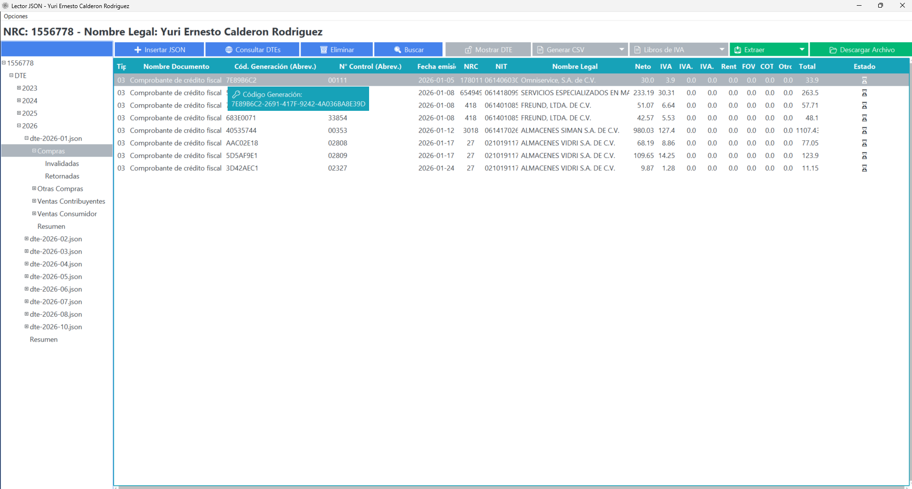{ align=center }

---

### 2. Visor Dual de DTEs (PDF y JSON)
PyConta ofrece una experiencia de visualización cómoda tanto para usuarios contables como para revisiones técnicas:

- **Vista Previa en PDF (Predeterminada)**: Al hacer **doble clic** sobre cualquier DTE en el listado, se abre directamente su representación gráfica en PDF, facilitando la lectura de ítems, precios, datos del cliente y sello de recepción.
- **Modo JSON Técnico**: Puedes alternar en cualquier momento a la vista de datos técnicos para consultar la estructura de datos original.

=== "Visualización en Modo PDF"
    Representación gráfica idéntica al documento impreso oficial:

    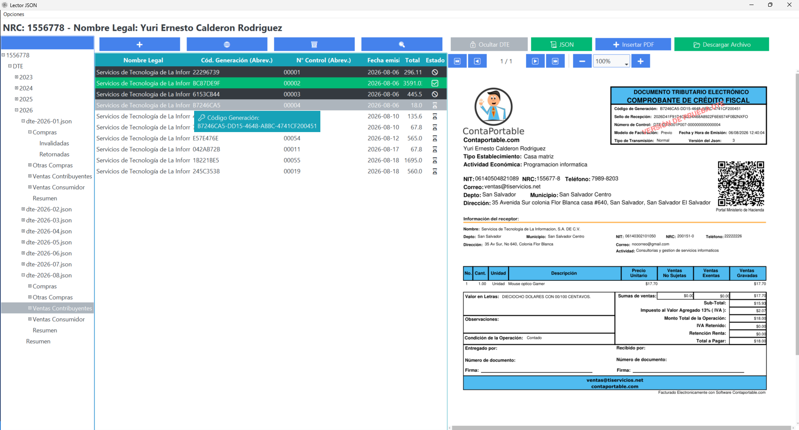{ align=center }

=== "Visualización en Modo JSON"
    Estructura de datos técnicos con todas las etiquetas del DTE:

    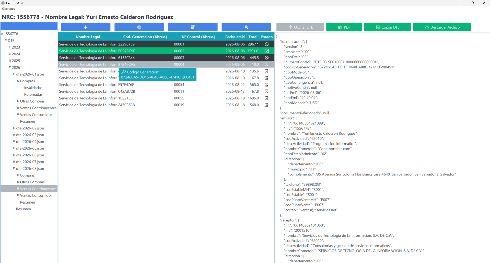{ align=center }

---

### 3. Menú Contextual (Clic Derecho) y Acciones Rápidas
Al hacer clic derecho sobre una o varias filas seleccionadas en la tabla, accedes a un menú con herramientas especializadas:

- **Consultar DTE**: Valida en tiempo real el estado del DTE con el servicio de consulta del Ministerio de Hacienda.
- **Copiar Datos Fiscales**: Copia rápidamente el Código de Generación, Número de Control, Sello de Recepción o NIT del proveedor al portapapeles.
- **Descargar / Guardar Archivo**: Guarda una copia local del archivo original en la carpeta que elijas.
- **Mover DTE**: Reclasifica el DTE a otro mes o año (con validación para evitar alterar periodos cerrados).

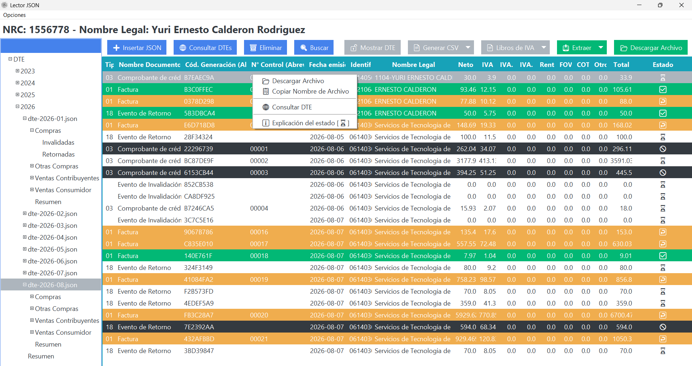{ align=center }

---

### 4. Búsqueda y Filtrado Rápido
La barra de búsqueda superior y el atajo **Ctrl + F** (en Windows) o **Cmd + F** (en macOS) tienen la capacidad de localizar DTEs filtrando en tiempo real por cualquier valor o columna existente en la tabla:
- Nombre o razón social del cliente o proveedor.
- Número de Identificación Tributaria (NIT / DUI) o NRC.
- Código de Generación, Número de Control o Sello.
- Montos y totales gravados o exentos.

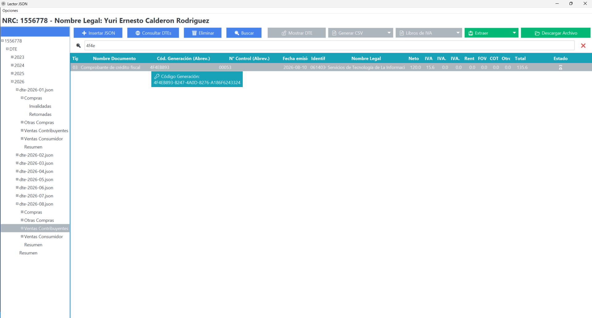{ align=center }

---

### 5. Resumen Financiero y Tarjetas KPI
El panel superior presenta un análisis visual automático del periodo seleccionado:
- Total de ventas y compras del periodo.
- Desglose de débitos y créditos fiscales.
- Indicador de margen y resumen operativo.

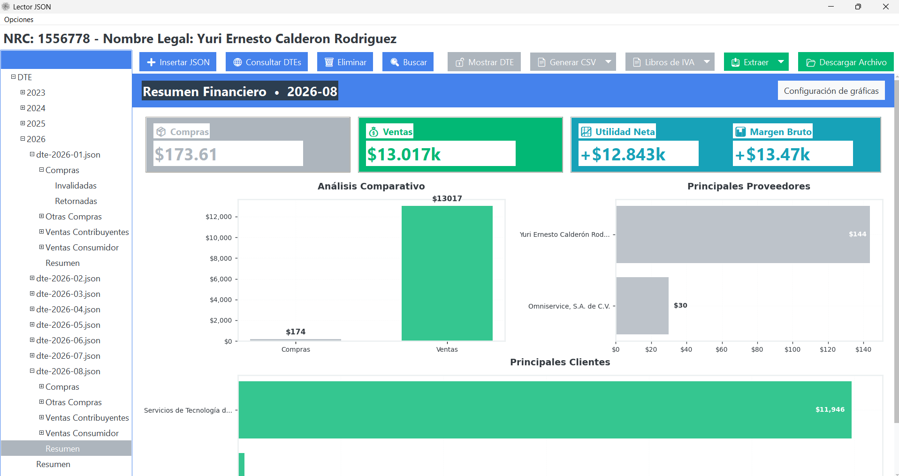{ align=center }

---

### 6. Opciones de Extracción y Exportación

=== "Exportar a Excel"
    Genera un archivo de Excel consolidado con todos los DTEs del periodo seleccionado, con columnas formateadas para evitar cortes en códigos largos.

    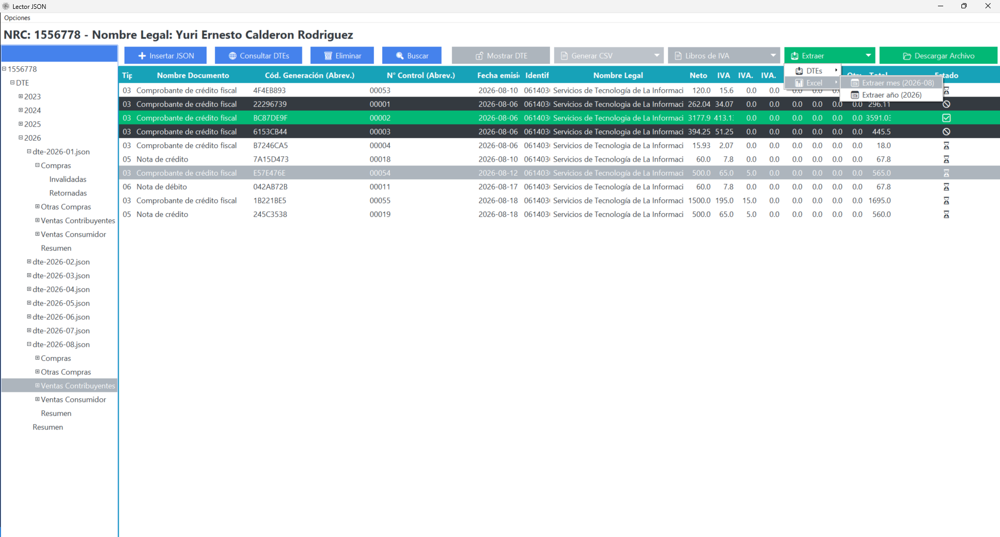{ align=center }

=== "Extraer DTEs"
    Empaqueta y extrae los archivos originales del periodo en la ubicación de tu equipo que definas.

    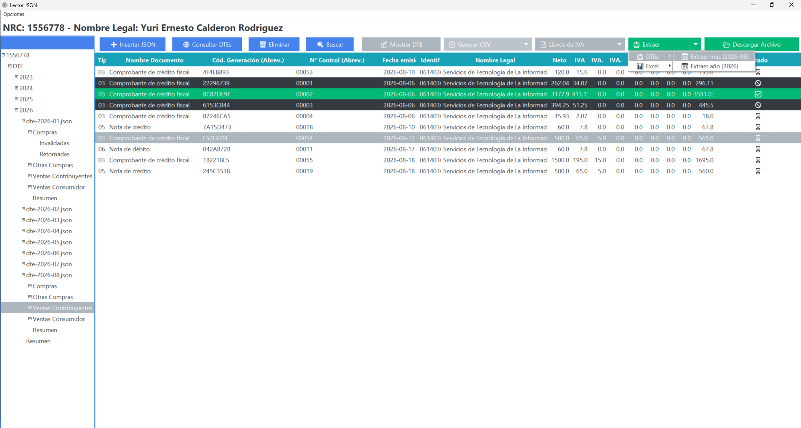{ align=center }

=== "Extraer Seleccionados"
    Permite exportar únicamente las filas que hayas marcado previamente en la tabla.

    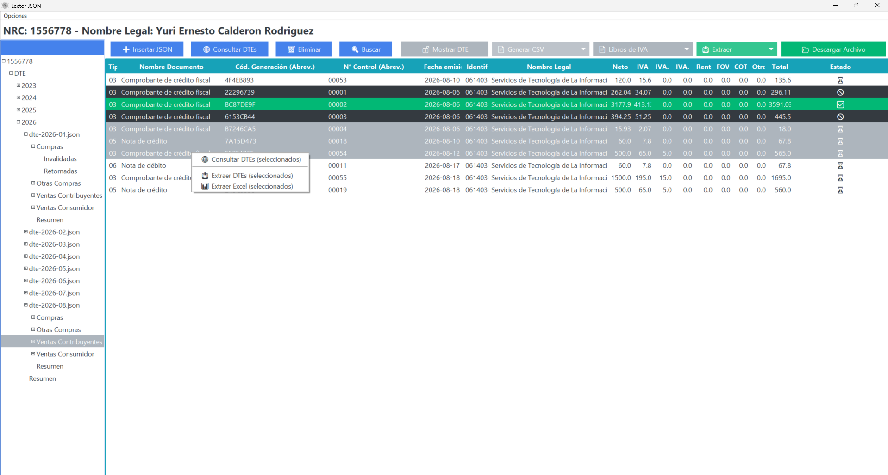{ align=center }

=== "Generar CSV"
    Exporta la vista tabular a formato CSV estándar para procesamiento externo o integración con otros sistemas.

    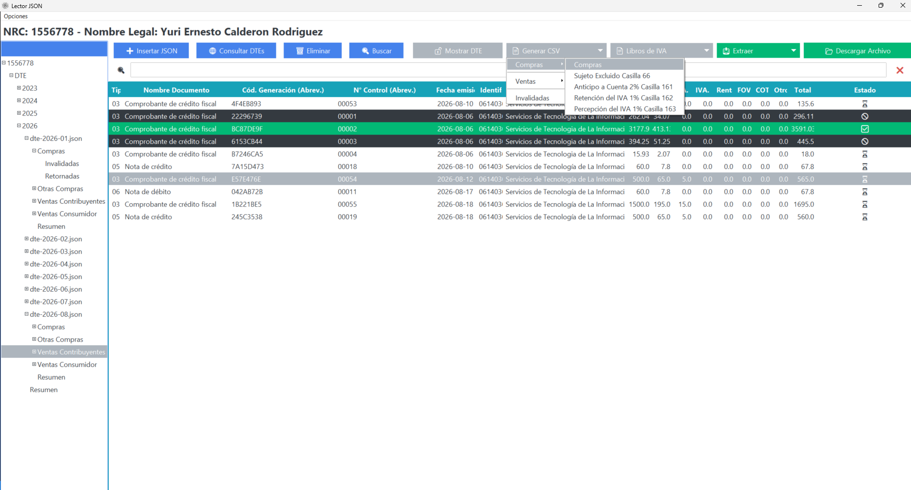{ align=center }

=== "Exportar Metadata"
    Desde el menú superior **Opciones > Exportar Metadata**, se abre un menú desplegable donde puedes seleccionar el **Año** y elegir entre **Exportar Año Completo** o un **Mes** específico. Esta función genera paquetes estructurados de metadata para análisis contable, conciliaciones y procesamiento con inteligencia artificial.

    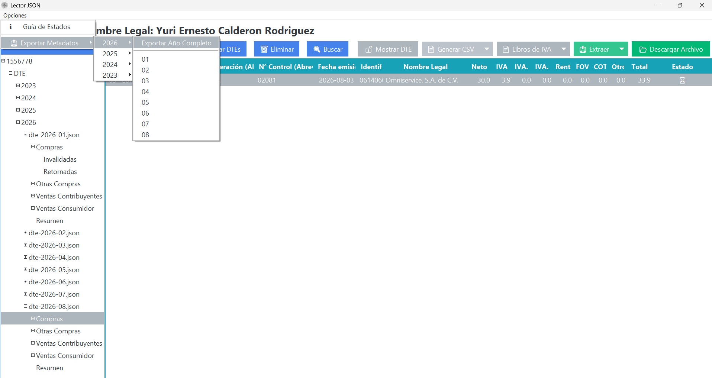{ align=center }

---

### 7. Acceso a Libros de IVA
Desde el botón principal de **Libros de IVA**, puedes abrir el módulo de generación de libros fiscales (Consumidor, Compras y Contribuyente) en formatos PDF y Excel.

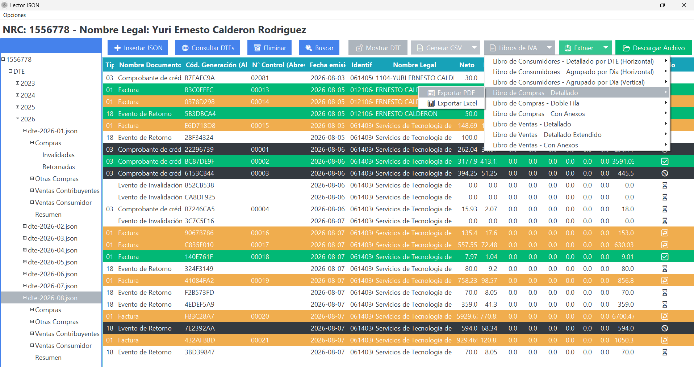{ align=center }

---

## **Enlaces Relacionados**
- [Consulta en Hacienda](consulta-hacienda.md)
- [Generación de Libros de IVA](libros-iva.md)
- [Anexos de Impuestos F07](anexos-de-impuestos-f07.md)
