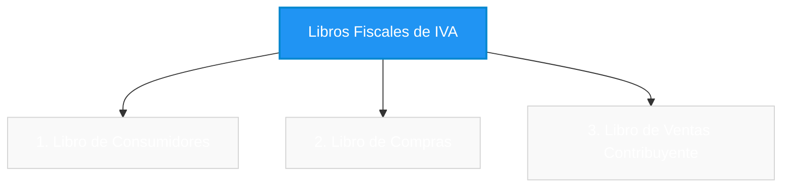
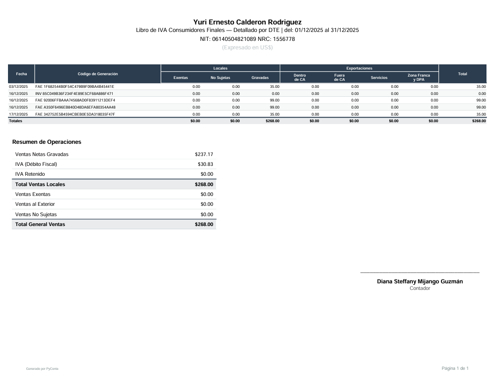
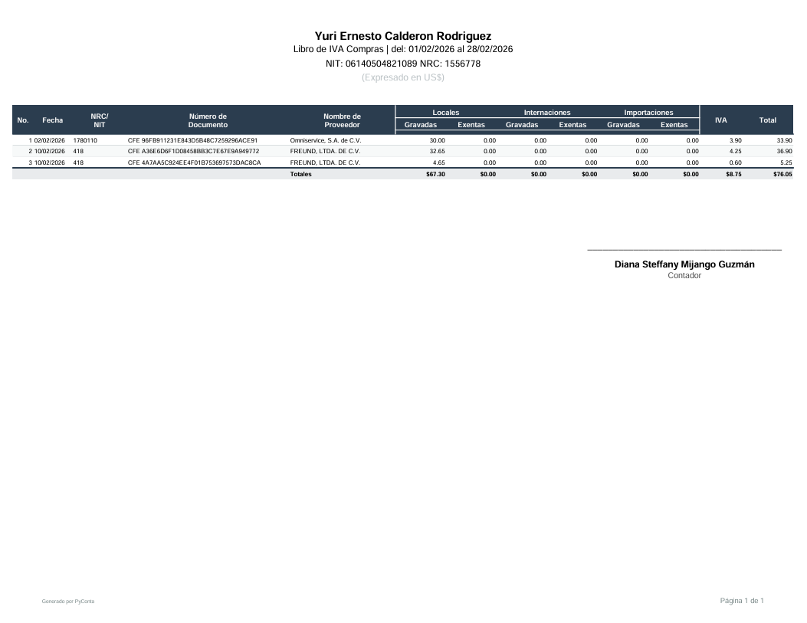
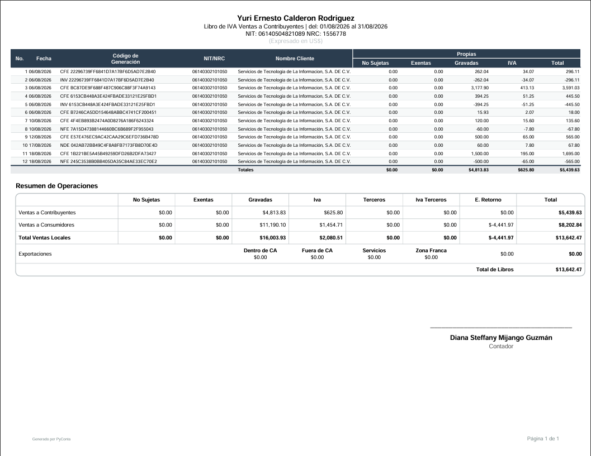

# **Libros de IVA**

PyConta genera automáticamente los libros fiscales obligatorios de IVA a partir de los DTEs procesados, ofreciendo exportaciones en formato **Excel** (para análisis contable) y **PDF** (diseñados para impresión y archivo oficial).

!!! info "Alcance de los Libros de IVA"
    Los Libros de IVA se generan exclusivamente a partir de los DTEs electrónicos procesados en el sistema. Los documentos físicos ingresados manualmente en la tabla de [Anexos de Impuestos F07](anexos-de-impuestos-f07.md) se destinan a la declaración tributaria y actualmente no se incluyen en los Libros de IVA.

---

---

## **1. Libro de Ventas a Consumidor Final**

Este libro consolida todas las facturas y DTEs emitidos a consumidores finales durante el periodo tributario.

### Formatos Disponibles:

=== "Detallado por DTE (Horizontal)"
    Presenta cada documento emitido de forma individual, desglosando fecha, número de control, sello de recepción, nombre del cliente, ventas exentas, no sujetas, gravadas y total.

=== "Agrupado por Día (Horizontal)"
    Consolida las ventas del día en una sola fila por fecha con distribución horizontal, ideal para operaciones comerciales de alto volumen diario.

=== "Agrupado por Día (Vertical)"
    Consolida las ventas por fecha en una distribución vertical optimizada, facilitando la lectura directa e impresión en formato compacto.

---

### Vista Previa y Descargas de Ejemplo:

{ align=center }

??? abstract "Libro de Consumidores - Descargas de ejemplo"
    - **[Descargar versión PDF detallado](../assets/reportes/impuestos/libros-iva/libros-iva-02-consumidor-detallado.pdf){ .md-button }**
    - **[Descargar versión PDF agrupada](../assets/reportes/impuestos/libros-iva/libros-iva-02-consumidor-agrupado.pdf){ .md-button }**
    - **[Descargar versión PDF agrupada vertical](../assets/reportes/impuestos/libros-iva/libros-iva-02-consumidor-agrupado-vertical.pdf){ .md-button }**
    - **[Descargar versión Excel detallada](../assets/reportes/impuestos/libros-iva/libros-iva-02-consumidor-detallado.xlsx){ .md-button }**
    - **[Descargar versión Excel agrupada](../assets/reportes/impuestos/libros-iva/libros-iva-02-consumidor-agrupado.xlsx){ .md-button }**

---

## **2. Libro de Compras**

Recopila todos los DTEs de compras recibidos (Comprobantes de Crédito Fiscal, Facturas de Sujeto Excluido, etc.), permitiendo determinar el IVA Crédito Fiscal acreditable del periodo.

### Formatos Disponibles:

=== "Detallado"
    Estructura estándar que detalla cada compra por fecha, número de documento, NIT/DUI y NRC del proveedor, nombre comercial, compras exentas, gravadas e IVA Crédito Fiscal.

=== "Doble Fila"
    Diseño compacto que organiza la información del proveedor y los montos fiscales en dos filas por registro para optimizar el espacio horizontal.

=== "Con Anexos"
    Incluye columnas específicas para percepciones de IVA y retenciones aplicables dentro del mismo libro principal.

---

### Vista Previa y Descargas de Ejemplo:

{ align=center }

??? abstract "Libro de Compras - Descargas de ejemplo"
    - **[Descargar versión PDF detallado](../assets/reportes/impuestos/libros-iva/libros-iva-03-compras-detallado.pdf){ .md-button }**
    - **[Descargar versión PDF doble fila](../assets/reportes/impuestos/libros-iva/libros-iva-03-compras-doble-fila.pdf){ .md-button }**
    - **[Descargar versión PDF con anexos](../assets/reportes/impuestos/libros-iva/libros-iva-03-compras-con-anexos.pdf){ .md-button }**
    - **[Descargar versión Excel detallada](../assets/reportes/impuestos/libros-iva/libros-iva-03-compras-detallado.xlsx){ .md-button }**

---

## **3. Libro de Ventas al Contribuyente**

Registra todas las operaciones de ventas realizadas a otros contribuyentes del IVA. Consolida en el resumen de operaciones todas las ventas.

### Formatos Disponibles:

=== "Detallado"
    Detalla los DTEs emitidos a contribuyentes, desglosando correlativo, NRC, NIT/DUI del cliente, razón social, operaciones gravadas, débito fiscal e impuestos específicos.

=== "Detallado Extendido"
    Incorpora el número de control y código de generación completo con ajuste de columnas optimizado.

=== "Con Anexos"
    Agrega columnas adicionales para reflejar percepciones de IVA y retenciones con el fin de no crear tablas adicionales en caso de tener DTEs aplicables.

---

### Vista Previa y Descargas de Ejemplo:

{ align=center }

??? abstract "Libro de Ventas al Contribuyente - Descargas de ejemplo"
    - **[Descargar versión PDF detallado](../assets/reportes/impuestos/libros-iva/libros-iva-04-contribuyente-detallado.pdf){ .md-button }**
    - **[Descargar versión PDF detallado extendido](../assets/reportes/impuestos/libros-iva/libros-iva-04-contribuyente-detallado-extendido.pdf){ .md-button }**
    - **[Descargar versión PDF con anexos](../assets/reportes/impuestos/libros-iva/libros-iva-04-contribuyente-con-anexos.pdf){ .md-button }**
    - **[Descargar versión Excel detallada](../assets/reportes/impuestos/libros-iva/libros-iva-04-contribuyente-detallado.xlsx){ .md-button }**

---

## **Características Destacadas de los Libros de IVA**

- **Salida en Excel Profesional**: Archivos `.xlsx` con anchos de columna adaptados para que los códigos de generación y números de control se lean completos sin truncarse.
- **Salida en PDF Lista para Impresión**: Paginación cuidada que evita que títulos o firmas queden huérfanos entre hojas.
- **Soporte de DUI como NIT**: Compatibilidad total con compras y ventas de personas naturales identificadas con DUI.
- **Tratamiento de Notas de Crédito**: Reflejo automático y deducción exacta de notas de crédito y débito.
- **Marcas de Agua**: Las cuentas en Plan Demo incluyen marca de agua demostrativa; las cuentas en Planes Premium generan libros de IVA limpios listos para presentación oficial.

---

## **Enlaces Relacionados**
- [Lector JSON](lector-json.md)
- [Anexos de Impuestos F07](anexos-de-impuestos-f07.md)
