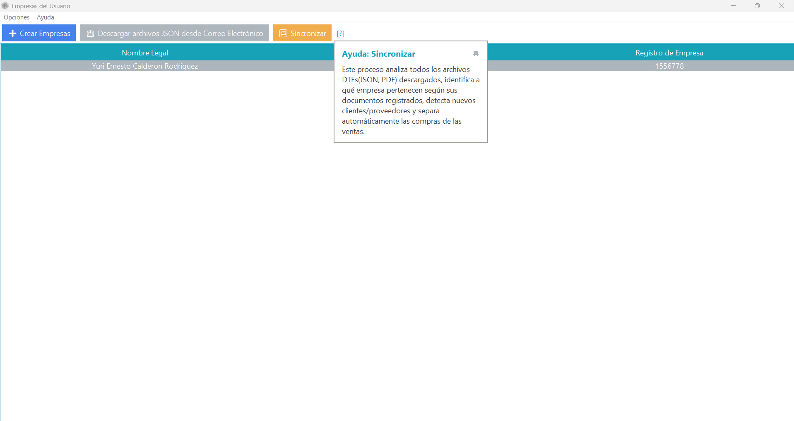
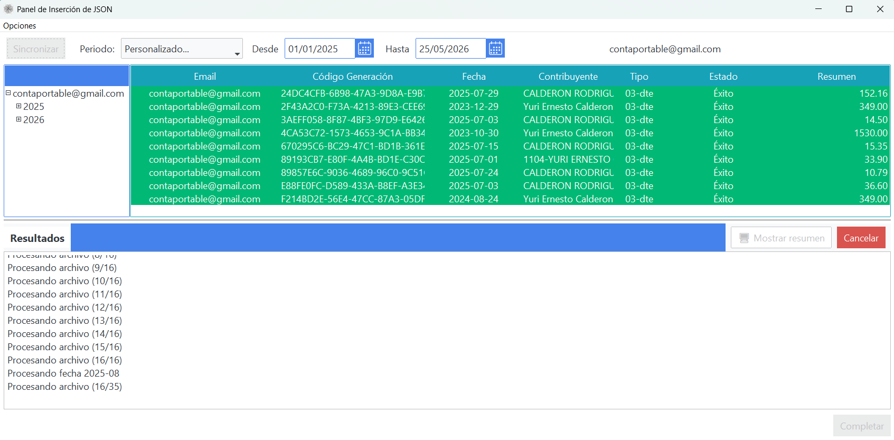
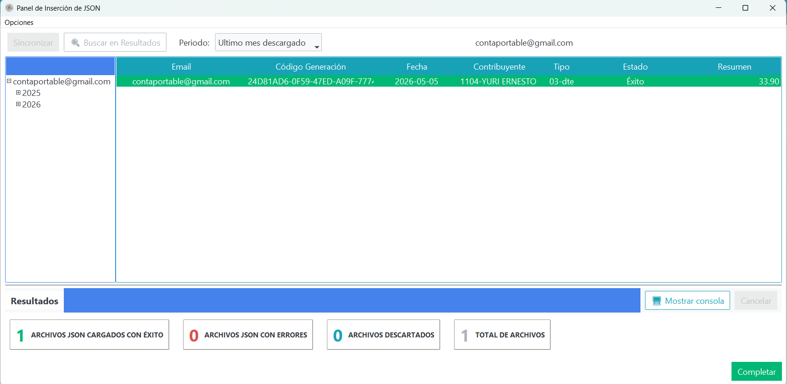

# **Sincronización de DTEs**

La sincronización es el proceso mediante el cual PyConta procesa los archivos descargados desde tus buzones de correo, validando su estructura y clasificándolos automáticamente en sus periodos y categorías correspondientes.

---

## **Flujo de Sincronización**

### 1. Acceso a la Sincronización
Desde el panel de descargas o el panel principal, presiona el botón de **Sincronizar** para iniciar el procesamiento de los archivos pendientes en tu carpeta de descargas:

{ align=center }

---

### 2. Procesamiento y Clasificación Automática
Durante la sincronización, PyConta realiza las siguientes acciones de forma automática:

- **Lectura de Archivos**: Lee e interpreta los archivos `.json` ubicados en la carpeta de descargas.
- **Validación de Identificadores**: Comprueba que el DTE pertenezca al NIT de la empresa activa (como emisor o receptor).
- **Clasificación en Categorías Fiscales**:
  - **Compras / Otras Compras**: DTEs donde la empresa actúa como receptor.
  - **Ventas Contribuyente / Ventas Consumidor**: DTEs donde la empresa actúa como emisor.
  - **Invalidadas**: Aloja los eventos de invalidación oficiales.
  - **Retornadas**: Aloja los eventos de retorno oficiales (disminución total o parcial en DTEs permisibles: **01** Factura, **11** FEX y **14** Sujeto Excluido, con efecto similar a notas de crédito).
- **Avance en Tiempo Real**: Muestra el progreso de carga y los estados de cada documento.

{ align=center }

---

### 3. Resultados de la Sincronización
Al concluir el proceso, el sistema presenta un resumen consolidado con el total de DTEs procesados con éxito, omitidos por duplicidad o con observaciones:

{ align=center }

!!! tip "Menú de Acciones y Visor de DTE"
    Al hacer clic derecho sobre cualquier fila en la tabla de sincronización, puedes acceder a opciones directas para copiar el nombre, el estado o examinar el documento en el [Visor de DTE](visor-dte.md).

---

## **Criterios de Verificación**
- Los DTEs aparecen correctamente ordenados en el árbol lateral del **Lector JSON**.
- Los contadores de resultados reflejan la cantidad esperada de archivos procesados.
- Los eventos de invalidación y documentos retornados se reflejan en sus categorías correspondientes.

---

## **Enlaces Relacionados**
- [Descarga Desde Correo](descarga-desde-correo.md)
- [Lector JSON](lector-json.md)
- [Consulta en Hacienda](consulta-hacienda.md)
