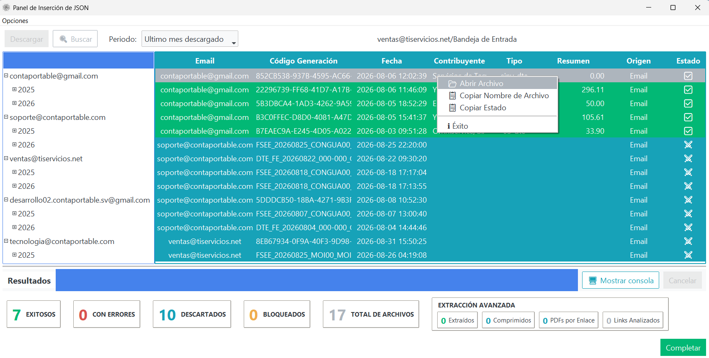
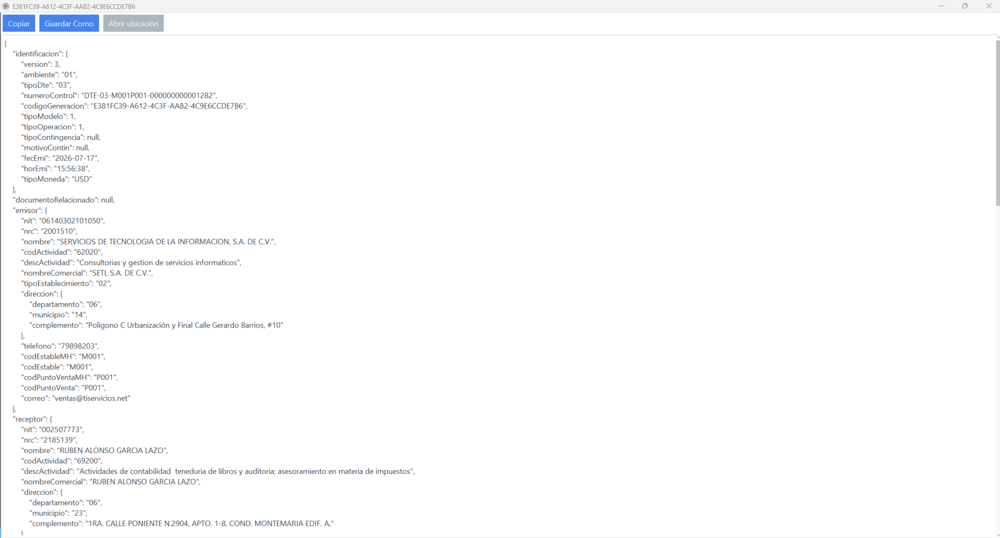

# **Visor de DTE**

El **Visor de DTE** es una herramienta integrada en el Panel de Inserción que permite inspeccionar la estructura completa de cualquier DTE procesado, además de ofrecer acciones rápidas de copia y gestión de archivos.

---

## **Acceso desde el Menú Contextual**
Durante la [Descarga Desde Correo](descarga-desde-correo.md), la [Sincronización](sincronizacion.md) o la [Inserción Local](importacion-json.md), puedes hacer clic derecho sobre cualquier fila de la tabla de resultados para desplegar el menú de acciones:

{ align=center }

### Opciones del Menú Contextual:
- **Abrir Archivo**: Abre la ventana del **Visor de DTE** para examinar el contenido JSON formateado del documento.
- **Copiar Nombre de Archivo**: Copia el nombre del archivo seleccionado directamente al portapapeles.
- **Copiar Estado**: Copia el estado de procesamiento del documento para facilitar auditorías o consultas de soporte.

---

## **Herramientas del Visor de DTE**
Al seleccionar **Abrir Archivo**, se despliega la vista detallada del documento mostrando su estructura JSON completa (datos de identificación, emisor, receptor, ítems y resumen financiero):

{ align=center }

### Acciones Disponibles en la Barra Superior:
- **Copiar**: Copia todo el contenido del JSON al portapapeles para pegarlo en editores externos o análisis complementarios.
- **Guardar Como**: Permite exportar y guardar una copia del archivo `.json` en cualquier carpeta de tu equipo.
- **Abrir ubicación**: Abre directamente el explorador de archivos en la carpeta donde reside el archivo original.

---

## **Enlaces Relacionados**
- [Descarga Desde Correo](descarga-desde-correo.md)
- [Sincronización de DTEs](sincronizacion.md)
- [Inserción Local de JSON](importacion-json.md)
- [Lector JSON](lector-json.md)
