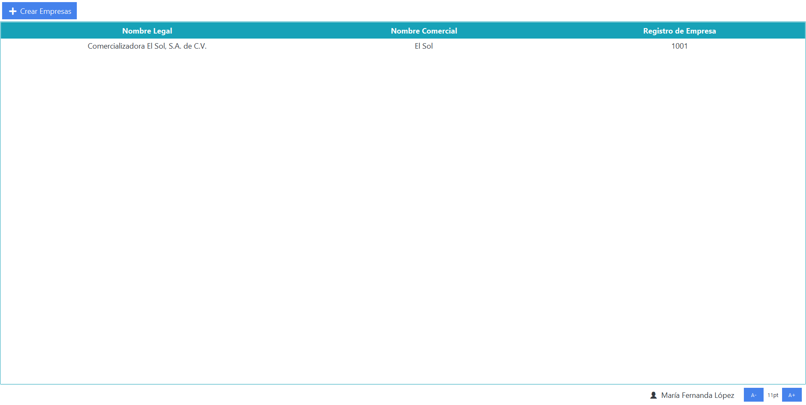
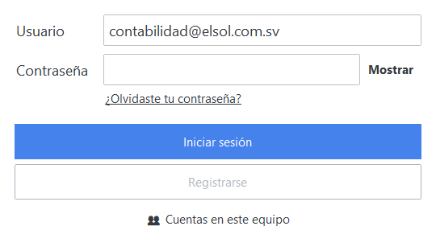
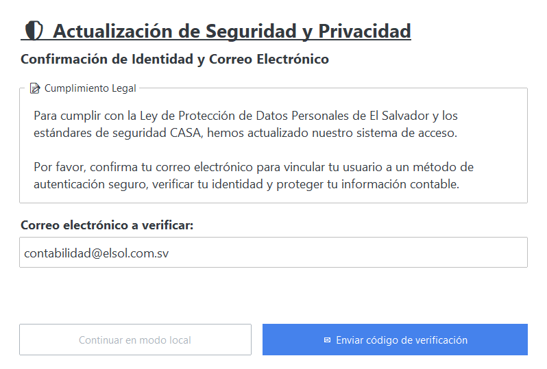
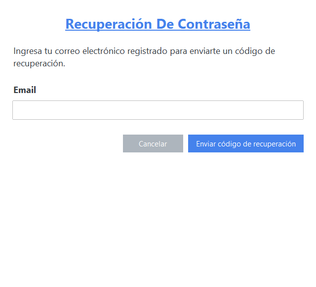

# **Instalación y Acceso**

Esta guía te orientará en el proceso de instalación y primer inicio de sesión en **PyConta**, dejándolo listo para comenzar a gestionar tus documentos tributarios electrónicos (DTE).

---

## **Antes de Empezar**

Asegúrate de contar con:

- **Instalador oficial**: Descarga el instalador correspondiente a tu sistema operativo (Windows o macOS) desde nuestro portal oficial.
- **Conexión a internet**: Necesaria para la validación inicial, vinculación de correos y activación de licencias.
- **Datos fiscales de tu empresa**: Información según tarjeta de IVA (Nombre Legal, NIT, NRC) para el registro de tu primera empresa.
- **Cuentas de correo**: Credenciales de los correos donde recibes o emites tus DTEs.

---

## **Instalación según tu Sistema Operativo**

=== "Windows"

    1. **Ejecutar el instalador**: Haz doble clic sobre el archivo de instalación descargado (`Setup_PyConta1.1_COMMON.exe`).
    2. **Instalación automática**: El sistema se instalará a nivel de tu usuario actual sin requerir permisos avanzados de administrador.
    3. **Acceso directo**: Se creará automáticamente un acceso directo en tu escritorio y en el menú de inicio.

=== "macOS"

    1. **Abrir la imagen de disco**: Haz doble clic sobre el archivo descargado (`PyConta1.0-macos.dmg`).
    2. **Arrastrar a Aplicaciones**: Arrastra el icono de **PyConta** a la carpeta **Aplicaciones** de tu Mac.
    3. **Primer inicio seguro**: Abre la aplicación desde el Launchpad o tu carpeta Aplicaciones. Si el sistema te solicita confirmación de seguridad para abrir la aplicación por primera vez, selecciona **Abrir**.

---

## **Primer Acceso a la Aplicación**

### 1. Pantalla de Carga y Panel Principal
Al iniciar PyConta, accederás al panel principal de empresas, que ahora incorpora una **barra de estado inferior** con el usuario activo y controles rápidos de zoom tipográfico (`- 10pt +`), además del menú superior **Opciones** para gestionar tu perfil, **Preferencias (`Ctrl+,`)**, **Administrar usuarios**, **Bitácora de actividades**, **Cambiar de Usuario** y **Cerrar Sesión**:

{ align=center }

### 2. Pantalla de Inicio de Sesión
Si es tu primera vez utilizando la aplicación, podrás crear tu cuenta o iniciar sesión con tus credenciales registradas. Además, desde el botón **Cuentas en este equipo** puedes consultar y seleccionar rápidamente los usuarios registrados en la computadora:

{ align=center }

!!! tip "Persistencia Inteligente y Cambio de Sesión"
    PyConta recuerda tu sesión de forma segura según el usuario del sistema operativo. Si trabajas en un equipo compartido, puedes usar **Opciones > Cambiar de Usuario** para alternar de cuenta rápidamente, o **Opciones > Cerrar Sesión** para desvincular el acceso activo de este dispositivo.

### 3. Actualización de Cuentas Anteriores (Migración Segura)
Si utilizabas una versión anterior de PyConta y tenías una cuenta local previa, tras iniciar sesión el sistema te guiará para confirmar tu correo electrónico y vincular tu usuario al nuevo método de autenticación segura mediante un código de verificación de 6 dígitos:

{ align=center }

Si decides posponer este paso temporalmente para trabajar en modo local, verás el botón **Completar migración** en la barra inferior del panel principal para retomarlo en cualquier momento.

---

## **Siguientes Pasos Recomendados**

1. **[Registro de Usuario](registro-usuario.md)**: Crea tu cuenta con código de verificación por correo y conoce el completado progresivo de perfil.
2. **[Preferencias](preferencias.md)**: Personaliza la tipografía, carpeta de descargas, filtros de DTEs y abreviaciones (`Ctrl+,`).
3. **[Registro de Empresa](registro-empresa.md)**: Registra tu empresa con sus datos fiscales y conecta tus cuentas de correo.
4. **[Licencias y Planes](licencias-y-planes.md)**: Conoce las diferencias entre el plan Demo y los planes Premium.

---

## **Resolución de Problemas Frecuentes**

- **Credenciales no válidas / Olvido de contraseña**: Utiliza la opción **¿Olvidaste tu contraseña?** en la pantalla de inicio de sesión para recibir un código de verificación de 6 dígitos en tu correo electrónico y definir una nueva contraseña:

{ align=center }

- **Conexión inestable**: Verifica que tu equipo tenga salida a internet para completar el proceso de autenticación y verificación por correo.
- **Soporte asistido**: Si requieres ayuda de nuestro equipo técnico, consulta cómo [Solicitar Soporte con PIN](../suscripcion-y-soporte/solicitar-soporte-con-pin.md).
