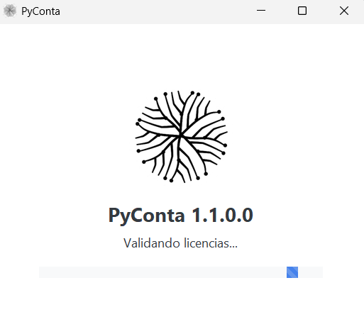
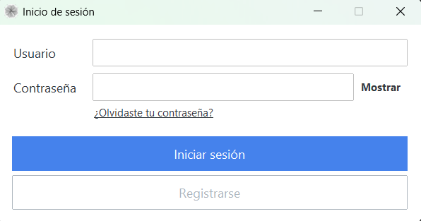

# **Instalación y Acceso**

Esta guía te orientará en el proceso de instalación y primer inicio de sesión en **PyConta**, dejándolo listo para comenzar a gestionar tus documentos tributarios electrónicos (DTE).

---

## **Antes de Empezar**

Asegúrate de contar con:

- **Instalador oficial**: Descarga el instalador correspondiente a tu sistema operativo (Windows o macOS) desde nuestro portal oficial.
- **Conexión a internet**: Necesaria para la validación inicial, vinculación de correos y activación de licencias.
- **Datos fiscales de tu empresa**: Información según tarjeta de IVA (Nombre Legal, NIT, NRC) para el registro de tu primera empresa.
- **Cuentas de correo**: Credenciales de los correos donde recibes o emites tus DTEs.

---

## **Instalación según tu Sistema Operativo**

=== "Windows"

    1. **Ejecutar el instalador**: Haz doble clic sobre el archivo de instalación descargado (`Setup_PyConta1.1_COMMON.exe`).
    2. **Instalación automática**: El sistema se instalará a nivel de tu usuario actual sin requerir permisos avanzados de administrador.
    3. **Acceso directo**: Se creará automáticamente un acceso directo en tu escritorio y en el menú de inicio.

=== "macOS"

    1. **Abrir la imagen de disco**: Haz doble clic sobre el archivo descargado (`PyConta1.0-macos.dmg`).
    2. **Arrastrar a Aplicaciones**: Arrastra el icono de **PyConta** a la carpeta **Aplicaciones** de tu Mac.
    3. **Primer inicio seguro**: Abre la aplicación desde el Launchpad o tu carpeta Aplicaciones. Si el sistema te solicita confirmación de seguridad para abrir la aplicación por primera vez, selecciona **Abrir**.

---

## **Primer Acceso a la Aplicación**

### 1. Pantalla de Carga Inicial
Al iniciar PyConta, se mostrará una pantalla de carga mientras se inicializan los servicios locales y la base de datos de trabajo:

{ align=center }

### 2. Pantalla de Inicio de Sesión
Si es tu primera vez utilizando la aplicación, podrás crear tu usuario local o iniciar sesión con tus credenciales registradas:

{ align=center }

---

## **Siguientes Pasos Recomendados**

1. **[Registro de Usuario](registro-usuario.md)**: Configura tu usuario, preguntas de seguridad para recuperación y preferencias generales.
2. **[Registro de Empresa](registro-empresa.md)**: Registra tu empresa con sus datos fiscales y conecta tus cuentas de correo.
3. **[Licencias y Planes](licencias-y-planes.md)**: Conoce las diferencias entre el plan Demo y los planes Premium.

---

## **Resolución de Problemas Frecuentes**

- **Credenciales no válidas**: Utiliza la opción de recuperación de contraseña respondiendo a tus preguntas de seguridad registradas.
- **Conexión inestable**: Verifica que tu equipo tenga salida a internet para completar el proceso de autenticación.
- **Soporte asistido**: Si requieres ayuda de nuestro equipo técnico, consulta cómo [Solicitar Soporte con PIN](../suscripcion-y-soporte/solicitar-soporte-con-pin.md).
