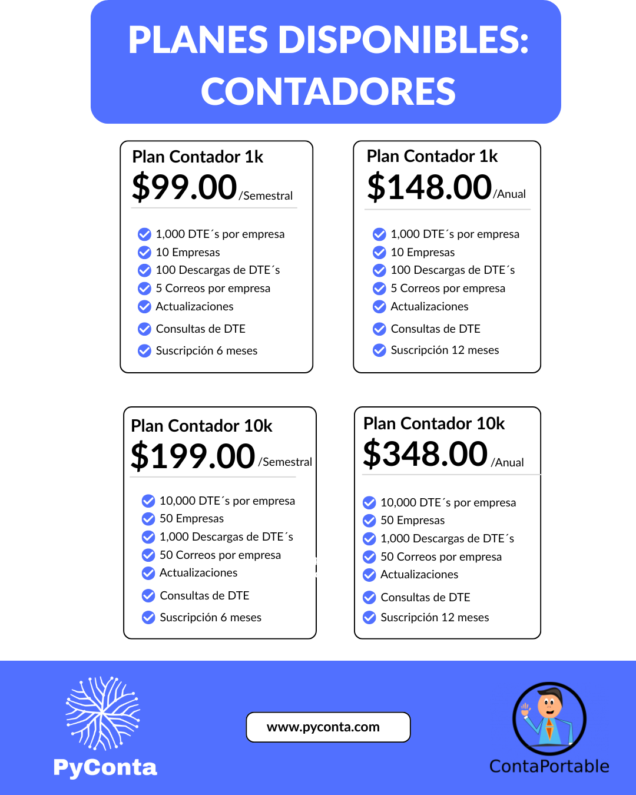
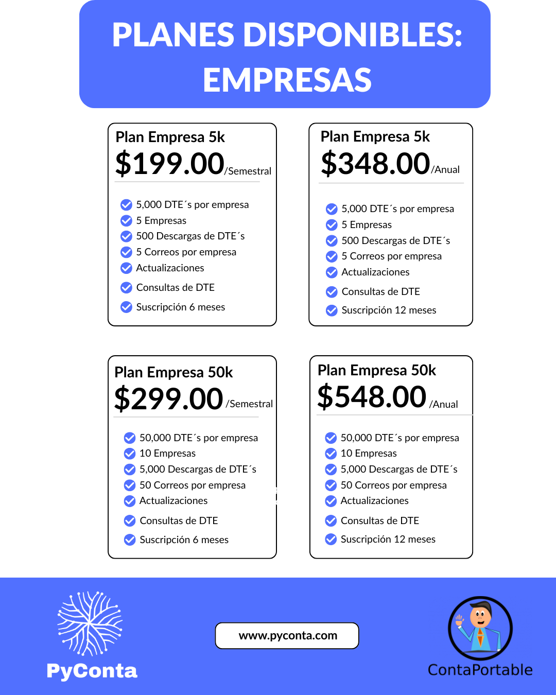
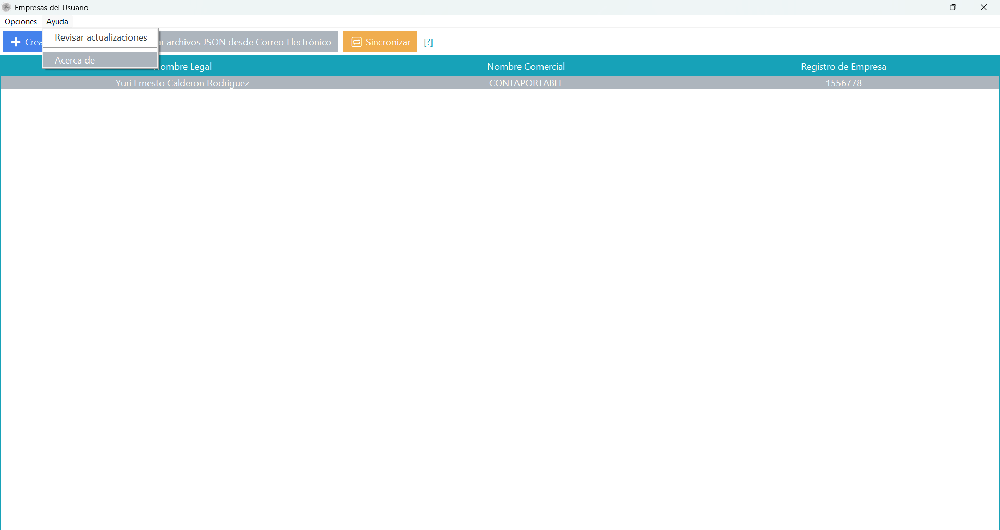
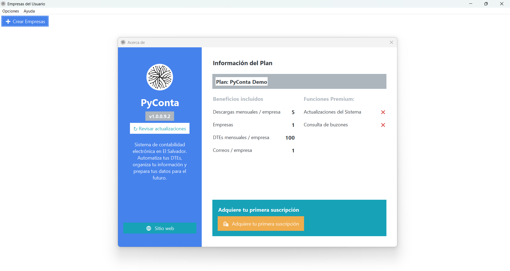
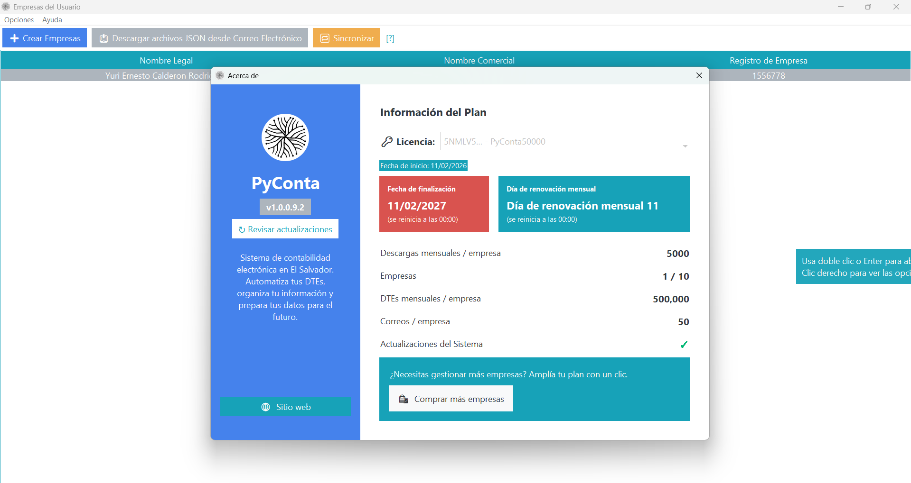

# **Licencias y Planes**

En esta sección conocerás las diferencias entre el **Plan Demo** gratuito y los **Planes Premium** disponibles para empresas y despachos contables, así como el procedimiento para consultar y activar tu licencia.

---

## **Plan Demo (Evaluación Gratuita)**

PyConta ofrece un Plan Demo diseñado para que puedas conocer la interfaz, probar la lectura de DTEs y familiarizarte con las herramientas antes de adquirir una suscripción.

### Características del Plan Demo:
- **Costo**: Gratuito.
- **Empresas**: 1 empresa registrada.
- **Descargas mensuales**: Hasta 5 ejecuciones de descarga.
- **Descargas de DTEs**: Hasta 100 DTEs.
- **Cuentas de correo**: 1 cuenta vinculada.
- **Libros de IVA**: Incluyen marca de agua de demostración en exportaciones PDF.
- **Consulta oficial en Hacienda**: Exclusiva de planes Premium.

---

## **Planes Premium (Empresas y Contadores)**

Los Planes Premium desbloquean la potencia completa de PyConta para la gestión contable profesional y el cumplimiento tributario continuo.

### Ventajas de los Planes Premium:
1. **Consulta Oficial en Hacienda**: Consulta individual y masiva inteligente de estados de DTEs directamente con el servicio de consulta del Ministerio de Hacienda.
2. **Libros de IVA**: Exportación en PDF y Excel sin marcas de agua, listos para auditorías y declaraciones tributarias.
3. **Mayor Capacidad de Procesamiento**: Registro de múltiples empresas, más cuentas de correo y volumen mensual adaptado a tus necesidades.
4. **Actualizaciones Continuas**: Acceso automático a las últimas mejoras, adaptaciones de normativa y nuevas herramientas.

### Planes Especializados:

=== "Planes para Contadores y Despachos"
    Diseñados para profesionales que administran múltiples clientes, requiriendo alta flexibilidad para cambiar entre empresas y centralizar libros de IVA.

    { align=center }

=== "Planes para Empresas"
    Diseñados para negocios y organizaciones que requieren gestionar sus compras, ventas y DTEs de forma automatizada y segura.

    { align=center }

---

## **Cómo Consultar tu Plan Activo en "Acerca de"**

Para verificar el estado de tu licencia, vigencia y límites actuales:

1. En la pantalla principal de PyConta, dirígete al menú superior **Ayuda**.
2. Selecciona la opción **Acerca de**.

{ align=center }

### Visualización según el tipo de cuenta:

=== "Vista en Plan Demo"
    Muestra los límites de prueba activos y un acceso directo para actualizar a un Plan Premium.

    { align=center }

=== "Vista en Plan Premium"
    Muestra el tipo de plan contratado, fecha de vencimiento, empresa asignada y estado de las funciones activas.

    { align=center }

---

## **Activación y Renovación de Licencia**

1. **Adquisición**: Gestiona tu clave de activación o renovación a través de nuestro equipo de ventas o portal web.
2. **Ingreso de Clave**: En el panel de tu empresa o desde la ventana de activación, ingresa la clave proporcionada.
3. **Verificación**: Confirma en la ventana **Acerca de** que el plan y las fechas de vigencia reflejen las condiciones contratadas.

---

## **Soporte Relacionado**
- [Solicitar Soporte con PIN](../suscripcion-y-soporte/solicitar-soporte-con-pin.md)
- [Renovación, Finalización y Upgrade](../suscripcion-y-soporte/renovacion-finalizacion-upgrade.md)
