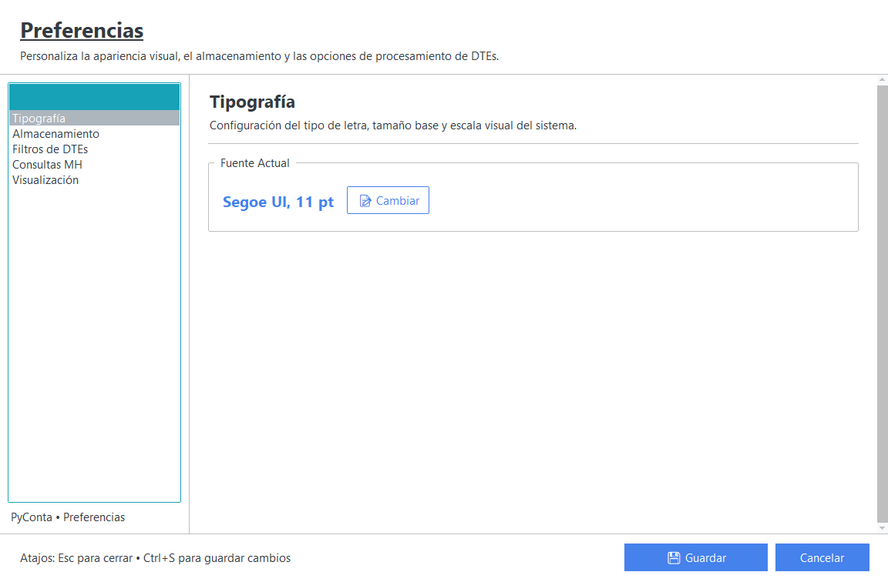
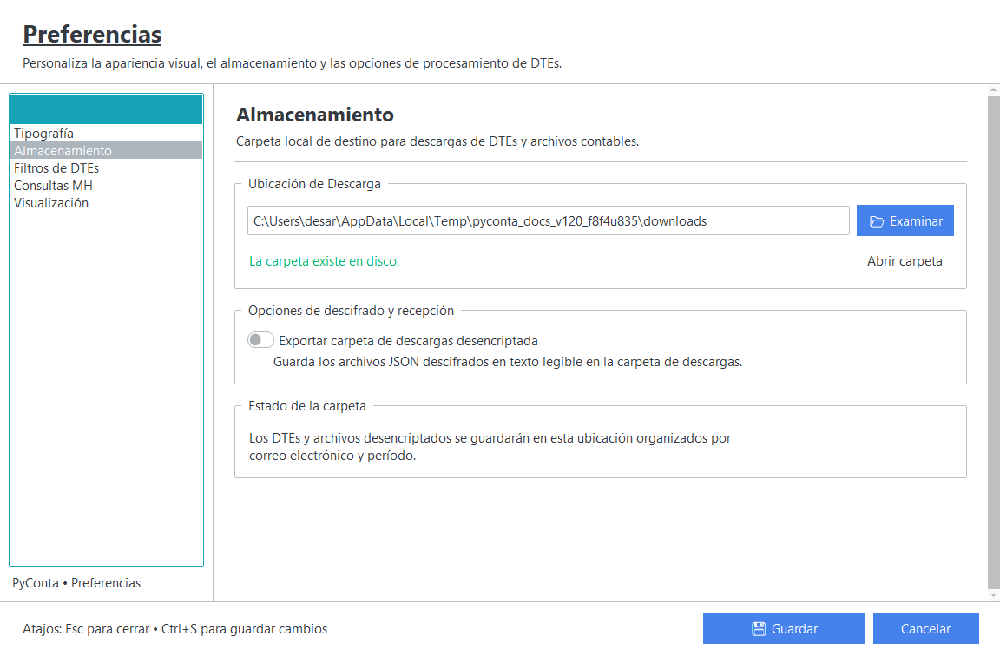
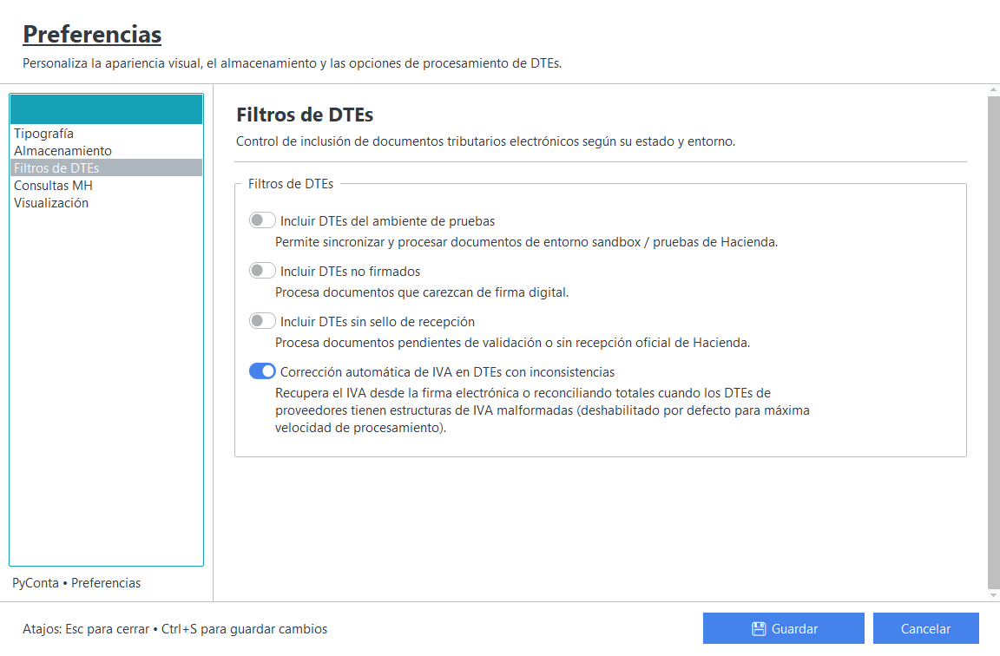
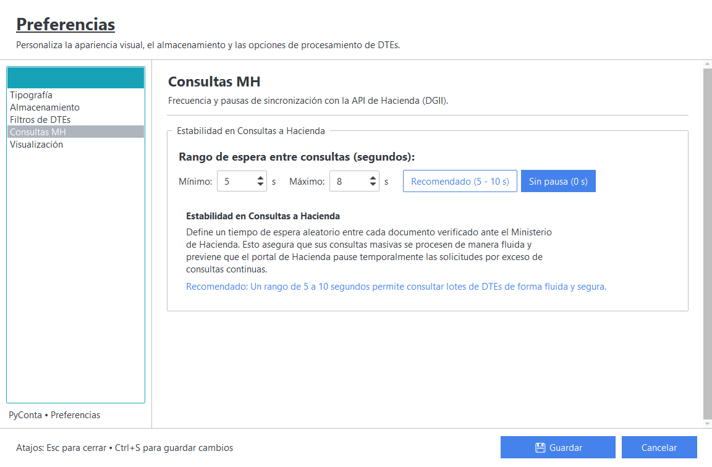
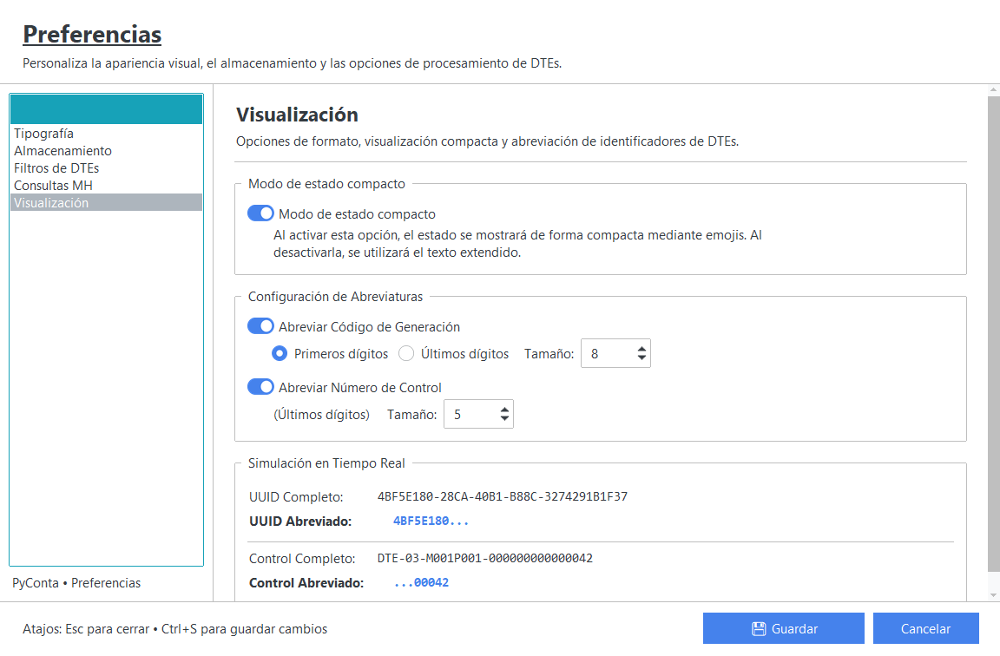

# **Preferencias del Sistema**

La ventana de **Preferencias** centraliza en un solo lugar la apariencia visual, la ruta de almacenamiento de descargas, las reglas de validación de DTEs, la estabilidad de consultas ante Hacienda y la abreviación de códigos en tablas.

---

## **Cómo Acceder a Preferencias**

Puedes abrir la ventana de Preferencias en cualquier momento desde la pantalla principal de **PyConta**:

- Menú superior **Opciones > Preferencias**.
- Atajo de teclado directo: **Ctrl + ,** (en Windows) o **Cmd + ,** (en macOS).

También puedes ajustar rápidamente el tamaño de letra sin abrir Preferencias utilizando los controles de zoom tipográfico (**`- 10pt +`**) ubicados en la barra de estado inferior de **Empresas** y del **Lector JSON**.

---

## **Secciones de Preferencias**

### 1. Tipografía
Permite personalizar la familia de fuente y el tamaño base aplicado de forma uniforme en todas las ventanas, formularios y tablas del sistema:

- **Selector de Fuente**: Elige la tipografía y el tamaño que resulten más cómodos para tu pantalla.
- **Escalado Automático**: Al modificar el tamaño, las filas de tablas y diálogos se reajustan automáticamente para evitar textos recortados.

{ align=center }

---

### 2. Almacenamiento
Define la carpeta de trabajo en tu computadora donde se guardarán los archivos descargados y las copias exportadas:

- **Carpeta de Descargas**: Selecciona o cambia la ruta local de almacenamiento e inspecciona su estado de disponibilidad.
- **Exportar descargas sin cifrado**: Activa esta opción si necesitas conservar una copia legible directa de los archivos descargados en la carpeta seleccionada.

{ align=center }

---

### 3. Filtros de DTEs
Configura las reglas de admisión y tratamiento contable al descargar o importar documentos:

- **Incluir ambiente de pruebas (`00`)**: Admite documentos de capacitación o pruebas técnicas.
- **Incluir documentos no firmados**: Permite procesar DTEs sin firma digital visible.
- **Incluir documentos sin sello**: Admite DTEs emitidos en contingencia o sin sello visible para regularizarlos posteriormente mediante la **Consulta en Hacienda**.
- **Corrección inteligente de IVA**: Admite documentos con diferencias menores de redondeo en el IVA asignándoles el estado preventivo (`⚠️`) sin interrumpir la carga masiva.
- **Usar fecha del correo para compras**: Registra las compras en el periodo contable correspondiente a la fecha de recepción del correo en lugar de la fecha de emisión.

{ align=center }

---

### 4. Consultas a Hacienda
Configura el espaciado entre peticiones al ejecutar consultas masivas ante el servicio de consulta del Ministerio de Hacienda:

- **Espera aleatoria entre consultas**: Define un rango mínimo y máximo de espera (en segundos; recomendado de **5 a 10 segundos**) entre cada documento verificado para mantener la estabilidad y prevenir bloqueos temporales por exceso de solicitudes continuas.

{ align=center }

---

### 5. Visualización
Personaliza la densidad visual y el formato compacto de identificadores largos dentro de las tablas del **Lector JSON**:

- **Modo compacto de estados**: Reduce el texto descriptivo en la columna de estado para priorizar el espacio horizontal.
- **Abreviar Código de Generación y Número de Control**: Permite mostrar únicamente los primeros o últimos dígitos de cada identificador (por ejemplo, últimos 8 o 5 caracteres) con un **simulador en tiempo real** para previsualizar el resultado antes de guardar.

{ align=center }

---

## **Enlaces Relacionados**
- [Parámetros de Validación](../flujos/parametros-validacion.md)
- [Registro de Usuario](registro-usuario.md)
- [Lector JSON](../flujos/lector-json.md)
- [Consulta en Hacienda](../flujos/consulta-hacienda.md)
