# **Registro de Empresa**

El registro de empresa te permite dar de alta una nueva entidad contable en **PyConta**, configurando sus datos fiscales, parámetros de firmas para libros de IVA, cuentas de correo asociadas y activación del plan.

---

## **Paso Previo: Crear Empresa**
Desde el panel principal de empresas, presiona el botón **Crear Empresa** para iniciar el asistente de configuración:

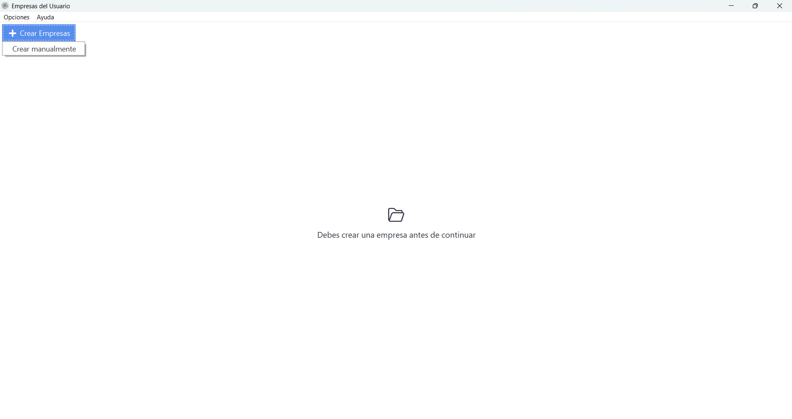{ align=center }

---

## **Flujo de Registro Paso a Paso**

### 1. Información de la Empresa
Completa los datos de identificación corporativa exactamente como constan en tu tarjeta de IVA y documentación legal:

- **Nombre Legal (Razón Social)**: Debe escribirse completo y exacto, ya que se utiliza para la activación del plan contratado.
- **Nombre Comercial**: Nombre visible de la empresa en la aplicación.
- **Giro o Actividad Económica**: Descripción de la actividad comercial.

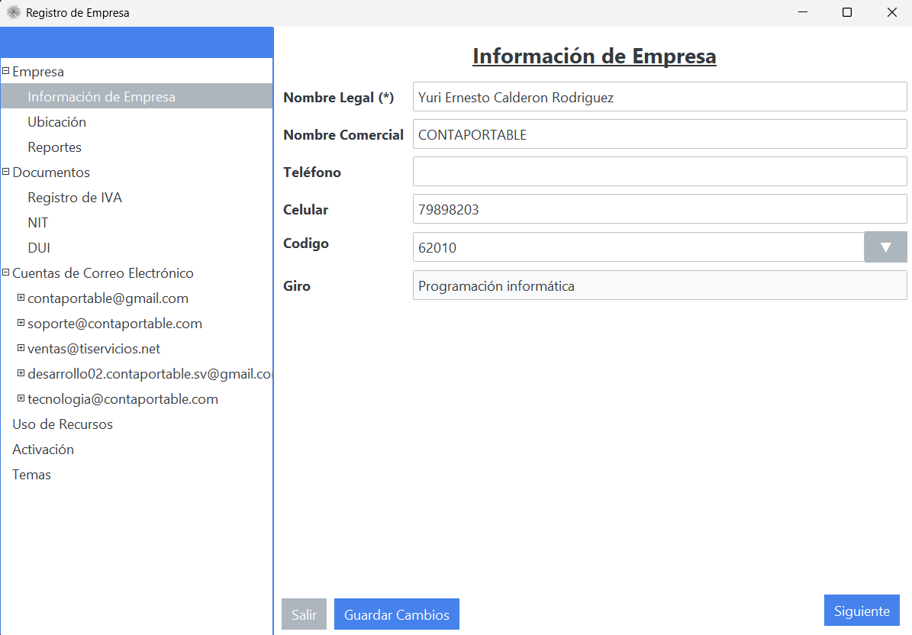{ align=center }

---

### 2. Ubicación
Registra los datos de domicilio fiscal de la entidad:

- País, departamento, municipio y distrito.
- Dirección exacta según constancia tributaria.

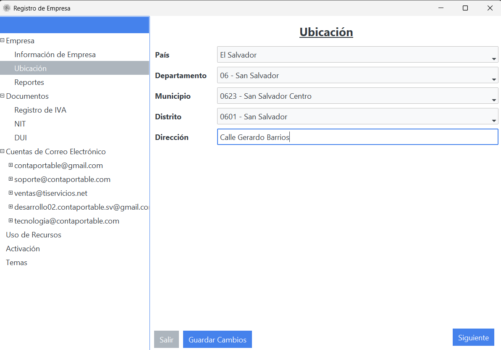{ align=center }

---

### 3. Reportes (Firmas y Parámetros de Libros de IVA)
Configura los datos del profesional contable responsable que figurarán en el pie de página de los Libros de IVA generados, así como las preferencias de exportación:

- **Firma de Libros de IVA**: Cargo o rol del responsable (por ejemplo, *Contador*, *Auditor* o *Representante Legal*).
- **Nombre del Firmante**: Nombre completo de la persona que autoriza o firma los libros fiscales.
- **Marca de Agua**: Casilla para controlar la visualización de la marca de agua en las exportaciones.

!!! info "Desactivación de Marca de Agua"
    En cuentas bajo el **Plan Demo**, la marca de agua se incluye obligatoriamente en todas las exportaciones de Libros de IVA en PDF. La opción para desactivar la marca de agua se habilita exclusivamente al contar con una suscripción **Premium** activa.

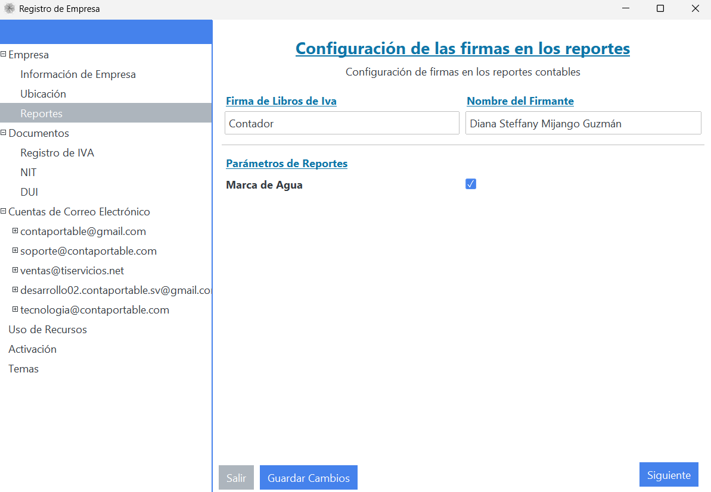{ align=center }

---

### 4. Registro de IVA (NRC)
Ingresa el Número de Registro de Contribuyente (NRC) de la empresa:

!!! warning "Importante"
    El Registro de IVA es un identificador crítico y no se puede modificar posteriormente una vez guardada la empresa.

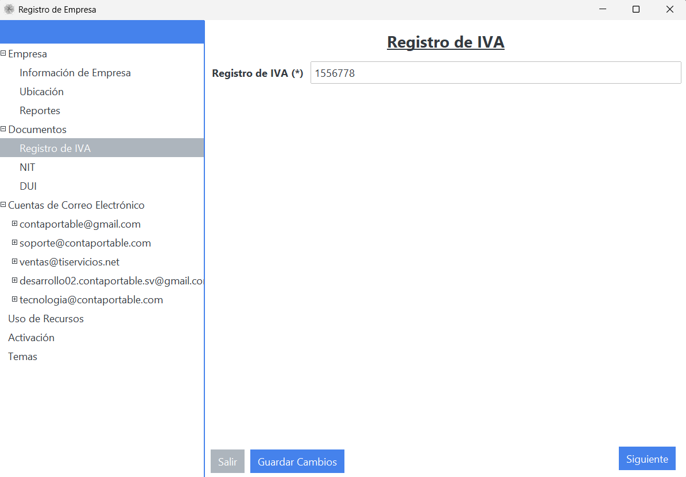{ align=center }

---

### 5. NIT
Ingresa el Número de Identificación Tributaria (NIT) asignado a la empresa:

!!! warning "Importante"
    El NIT debe coincidir exactamente con el documento oficial y no se puede editar una vez registrado.

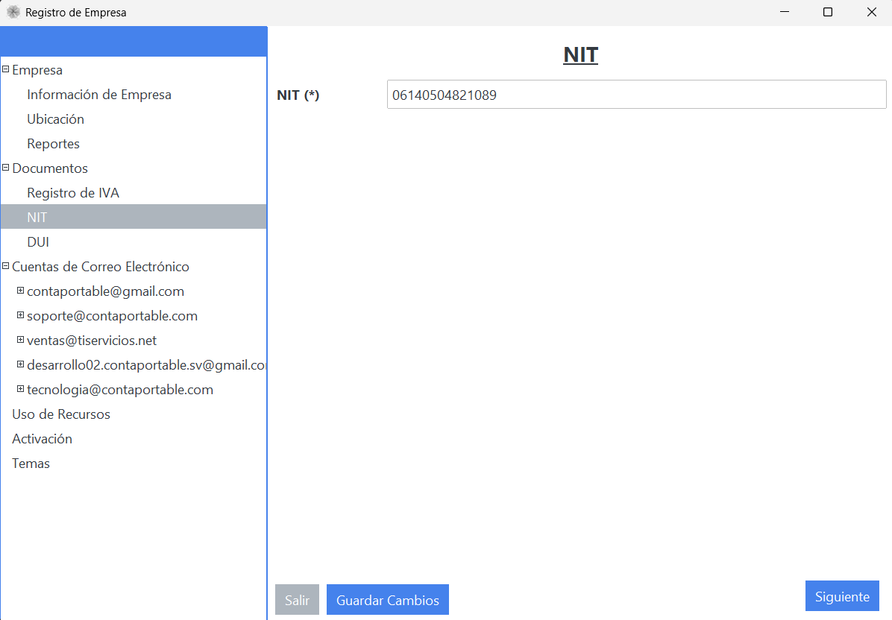{ align=center }

---

### 6. DUI (Opcional)
Campo opcional aplicable cuando una persona natural o entidad no contribuyente desea gestionar sus compras y registrar un control financiero personal.

---

### 7. Cuentas de Correo Electrónico
Vincula los buzones de correo que se utilizarán para la descarga automática de DTEs:

- Selecciona el proveedor (**Google Gmail**, **Microsoft Outlook** o **Servidor IMAP personalizado**).
- Define la carpeta de descarga (por ejemplo, *Bandeja de Entrada* o *Enviados*) y el rol correspondiente (*Compras / Receptor* o *Ventas / Emisor*).

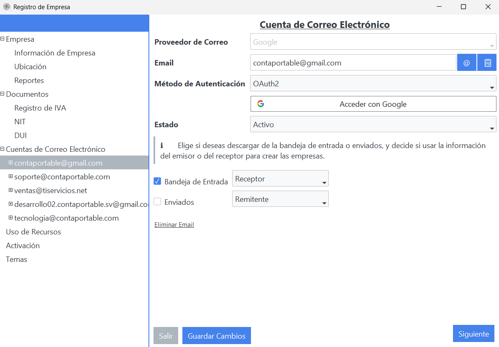{ align=center }

=== "Autenticación OAuth con Google"
    Al vincular cuentas Gmail, autoriza los permisos de lectura solicitados en la ventana segura del navegador:

    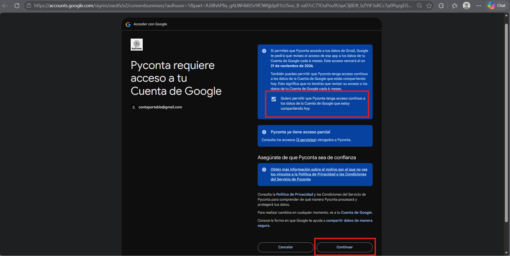{ align=center }

=== "Confirmación de Conexión"
    Una vez concedidos los permisos, el sistema confirmará la vinculación exitosa de la cuenta:

    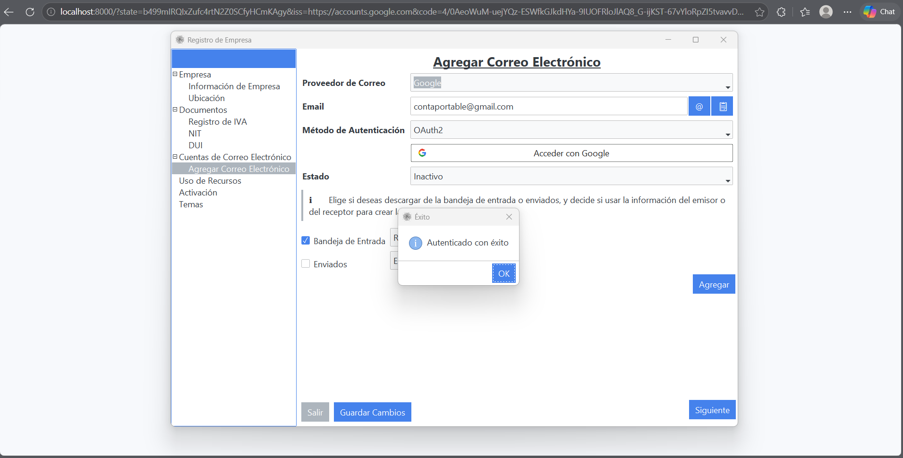{ align=center }

---

### 8. Activación del Plan
Si cuentas con una suscripción a un Plan Premium, introduce tu clave de activación para aplicar los beneficios y cupos del plan contratado:

=== "Ingreso de Clave de Activación"
    Ingresa la clave proporcionada para activar la suscripción en la empresa:

    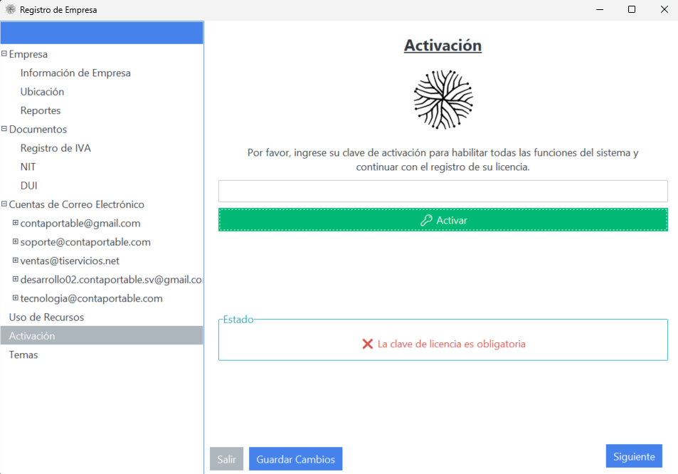{ align=center }

=== "Activación Exitosa"
    Verifica el tipo de plan asignado, la fecha de vigencia y los límites de procesamiento:

    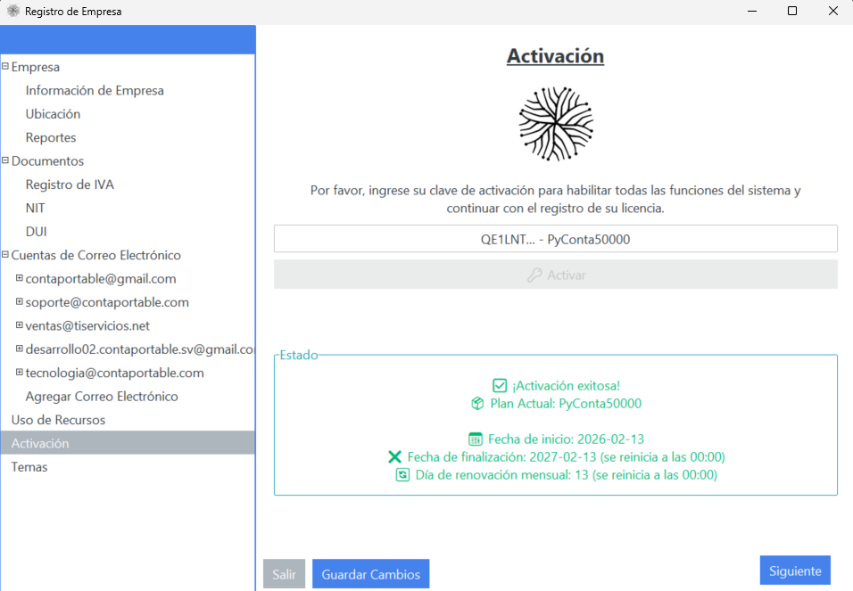{ align=center }

---

### 9. Temas y Personalización
Selecciona el tema visual de tu preferencia para adaptar los colores de la interfaz a tu gusto:

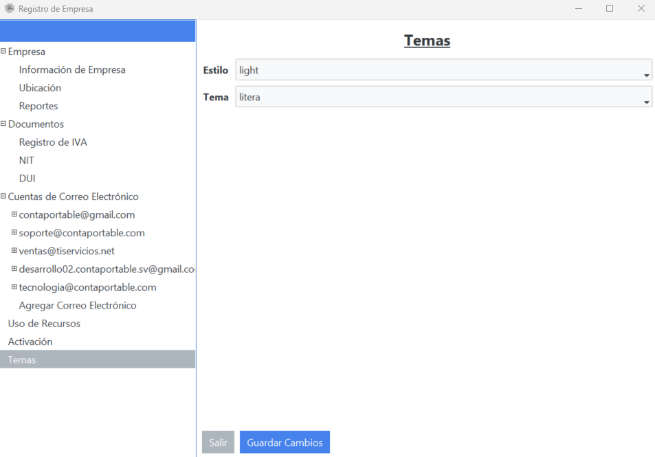{ align=center }

---

## **Verificación**
- La empresa aparece en la lista principal con su estado activo.
- Los datos fiscales (NIT y NRC) coinciden con los DTEs a procesar.
- Los Libros de IVA generados reflejan el nombre y cargo del firmante configurado.

---

## **Enlaces Relacionados**
- [Crear Primera Empresa](crear-primera-empresa.md)
- [Descarga Desde Correo](../flujos/descarga-desde-correo.md)
- [Generación de Libros de IVA](../flujos/libros-iva.md)
- [Licencias y Planes](licencias-y-planes.md)
