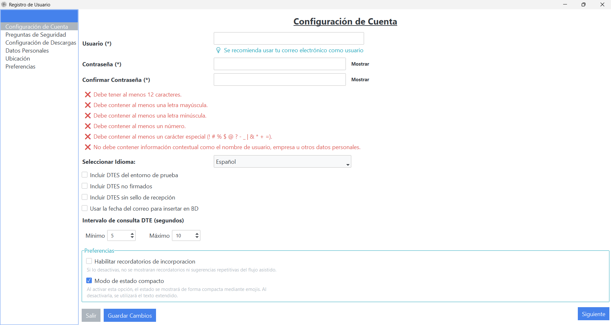
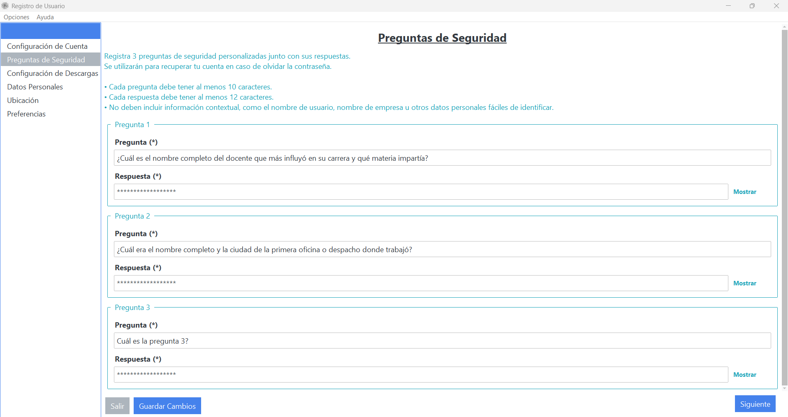
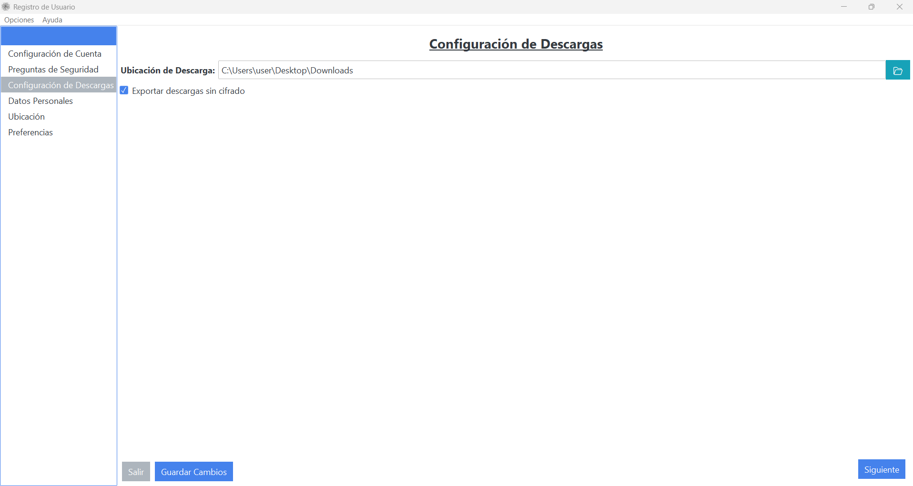
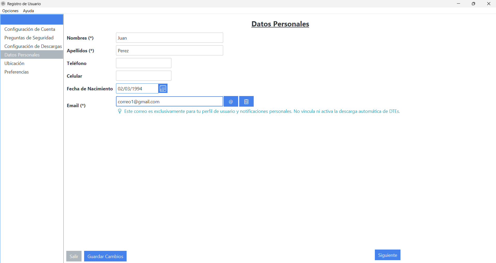
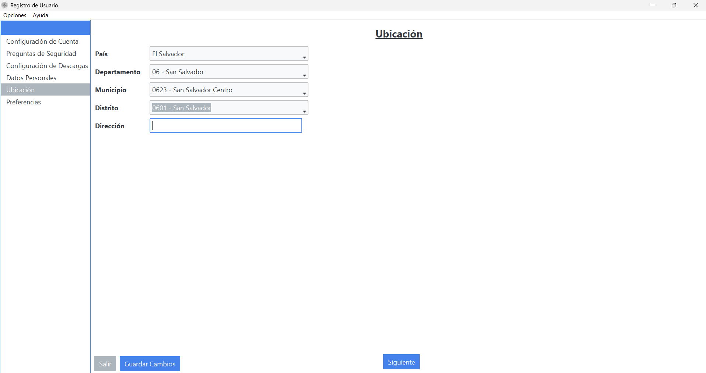
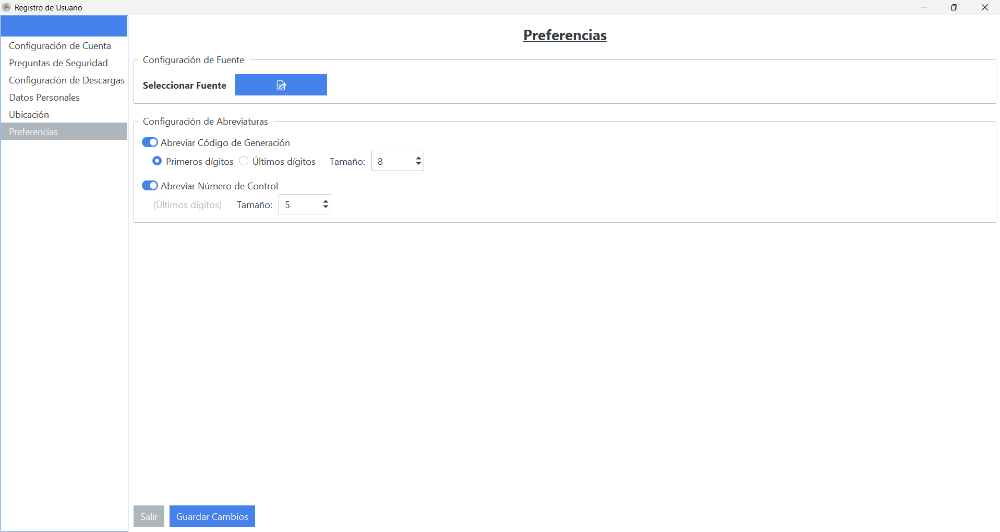
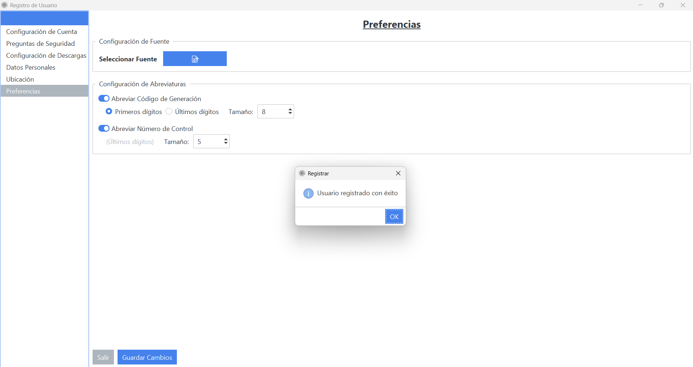

# **Registro de Usuario**

El proceso de registro te permite configurar tu cuenta principal de acceso a **PyConta**, estableciendo tus credenciales, parámetros operativos, preguntas de recuperación y preferencias visuales.

---

## **Antes de Empezar**
- Disponer de conexión a internet para la activación inicial.
- Contar con una dirección de correo electrónico válida.

---

## **Flujo de Registro Paso a Paso**

### 1. Configuración de Cuenta
En este primer paso se configuran las reglas base de operación del usuario:

- **Contraseña y validación**: Establece una contraseña segura.
- **Usar fecha del correo para compras**: Permite registrar las compras con la fecha de recepción del correo cuando corresponda a tu flujo de trabajo.
- **Intervalo de consulta en Hacienda**: Define el tiempo de espera entre peticiones durante consultas masivas.
- **Preferencias del asistente**: Habilita o deshabilita los mensajes guiados de bienvenida.

{ align=center }

---

### 2. Preguntas de Seguridad
Las preguntas de seguridad son el método exclusivo para recuperar el acceso a tu cuenta en caso de olvido de credenciales:

- Selecciona preguntas claras con respuestas precisas que puedas recordar.
- Resguarda las respuestas en un medio interno seguro.

!!! warning "Importante"
    Si se extravían las respuestas a las preguntas de seguridad, la recuperación del acceso a tu usuario no será posible.

{ align=center }

---

### 3. Configuración de Descargas
Define la ubicación en tu computadora donde se almacenarán los archivos descargados:

- Por defecto, se asigna la carpeta de trabajo de la aplicación.
- Puedes seleccionar una ruta personalizada en tu disco si lo requieres.
- **Exportar descargas sin cifrado**: Activa esta opción si necesitas disponer de los archivos individuales directamente en dicha carpeta.

{ align=center }

---

### 4. Datos Personales
Ingresa tu información de contacto:

- Nombres y apellidos completos.
- Correo electrónico principal.
- Número de teléfono o contacto.

{ align=center }

---

### 5. Ubicación
Completa los datos de ubicación geográfica:

- País, departamento, municipio y distrito.
- Dirección para mantener coherencia en los registros.

{ align=center }

---

### 6. Preferencias: Configuración de Fuente y Abreviaturas
Este panel te permite personalizar la apariencia visual y la visualización de datos en las tablas de DTEs:

- **Configuración de Fuente**: Permite seleccionar una tipografía personalizada para toda la aplicación.
- **Configuración de Abreviaturas**:
  - **Abreviar Código de Generación**: Permite compactar la visualización del código en las tablas eligiendo entre mostrar los *Primeros dígitos* o *Últimos dígitos*, y estableciendo la cantidad de caracteres visibles (por ejemplo, 8).
  - **Abreviar Número de Control**: Permite acortar el número de control mostrando únicamente los últimos dígitos (por ejemplo, 5), ahorrando espacio horizontal en las columnas del visor.

{ align=center }

---

### 7. Confirmación de Registro
Al finalizar el formulario, presiona **Guardar Cambios** para completar la creación de tu usuario:

{ align=center }

---

## **Verificación Posterior**
- Inicia sesión con tu nuevo usuario y accede al panel principal de PyConta.
- Comprueba tu estado de suscripción y límites en la ventana **Acerca de**.

---

## **Enlaces Relacionados**
- [Instalación y Primer Acceso](instalacion-acceso.md)
- [Crear Primera Empresa](crear-primera-empresa.md)
- [Licencias y Planes](licencias-y-planes.md)
