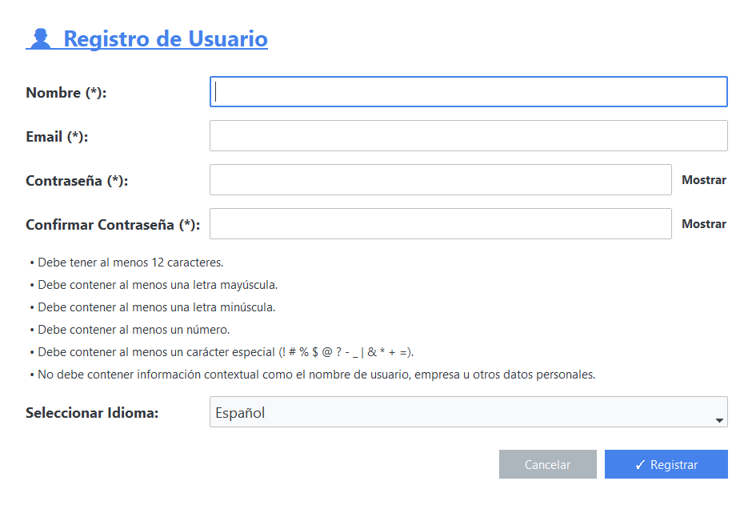
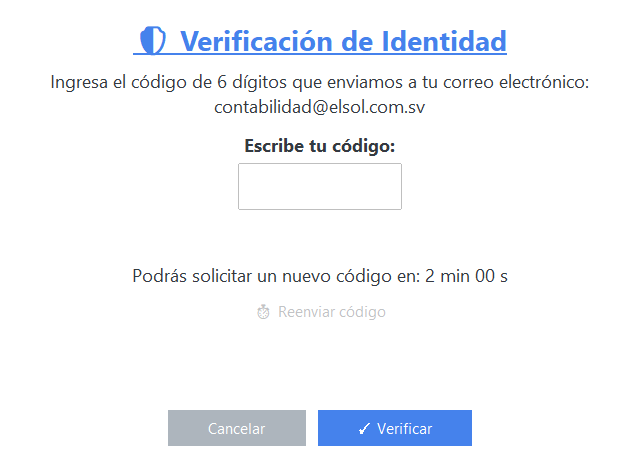
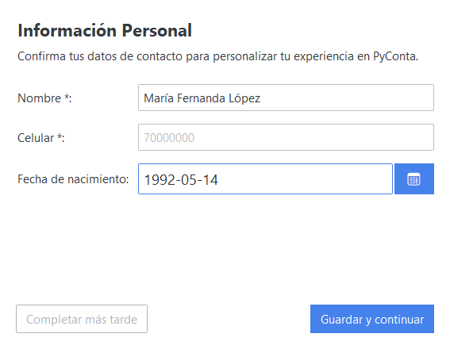
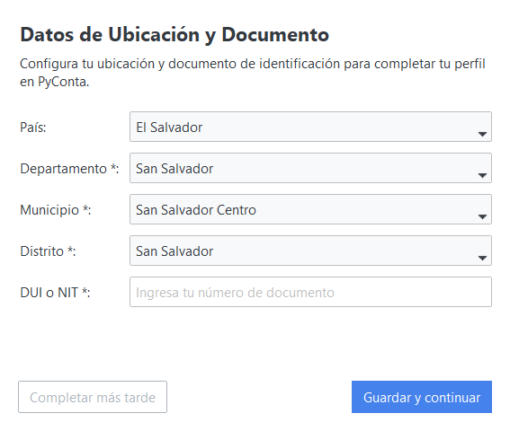
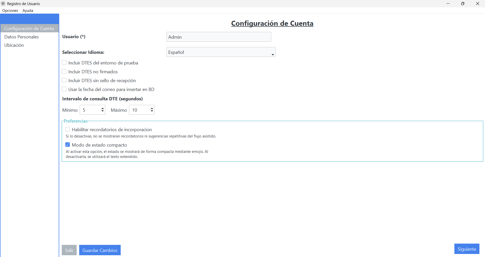
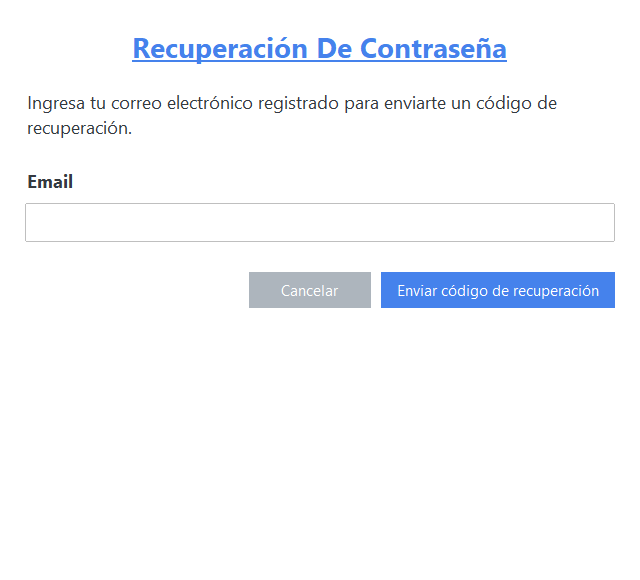
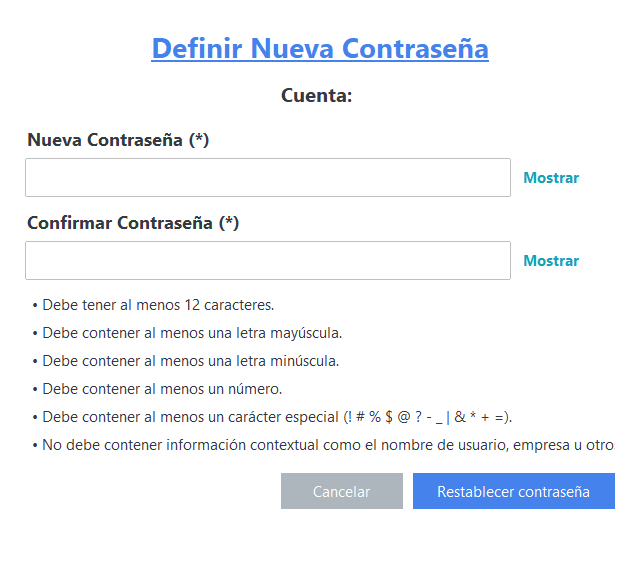
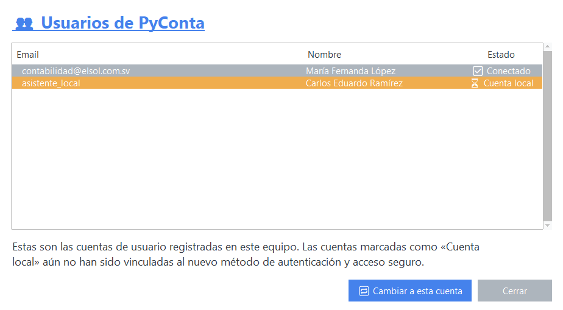

# **Registro y Gestión de Usuario**

El proceso de registro de **PyConta** está diseñado para que comiences a trabajar en segundos con una cuenta verificada, segura y alineada con los estándares de protección de datos y seguridad **CASA Nivel 2**.

---

## **Antes de Empezar**
- Disponer de conexión a internet para la verificación inicial de tu correo electrónico.
- Contar con una dirección de correo electrónico válida y accesible.

---

## **Flujo de Registro Paso a Paso**

### 1. Registro Inicial Simplificado
Al seleccionar **Registrarse** desde la pantalla de inicio de sesión, solo necesitas completar los datos esenciales de tu cuenta:

- **Nombre**: Tu nombre completo.
- **Correo electrónico**: Dirección principal que identificará tu cuenta y recibirá los códigos de verificación o recuperación.
- **Contraseña y Confirmación**: Establece una contraseña segura siguiendo los indicadores de requisitos en tiempo real.
- **Idioma**: Selecciona el idioma de preferencia de la interfaz (Español o Inglés).

{ align=center }

---

### 2. Confirmación de Correo con Código de Verificación
Al enviar el formulario de registro, PyConta enviará un **código de verificación de 6 dígitos** a tu correo electrónico para confirmar tu identidad y activar tu cuenta:

- Ingresa el código recibido en la ventana de verificación.
- Si el correo demora, dispones de un temporizador de reenvío (120 segundos) y sugerencias contextuales para revisar carpetas de correo no deseado según tu proveedor.

{ align=center }

---

## **Completado Progresivo de Perfil (*Onboarding*)**

Para evitar formularios extensos desde el primer día, PyConta solicita los datos complementarios de tu perfil de forma gradual en tus siguientes sesiones de trabajo:

=== "Sesión 3: Datos Personales"
    En tu tercera sesión, el sistema te invitará a confirmar tu **Nombre**, **Teléfono celular** (8 dígitos) y opcionalmente tu **Fecha de nacimiento**:

    { align=center }

=== "Sesión 5: Ubicación y Documento"
    En tu quinta sesión, completarás tu **País**, **Departamento**, **Municipio**, **Distrito** y número de **DUI o NIT**:

    { align=center }

---

## **Editar Perfil y Configurar Preferencias**

Una vez dentro de la aplicación, puedes consultar o actualizar tu información desde el menú superior **Opciones**:

- **Opciones > Configuración de usuario**: Abre el editor de perfil con tus 3 secciones vigentes (**Configuración de Cuenta**, **Datos Personales** y **Ubicación**):

{ align=center }

- **Opciones > Preferencias (`Ctrl+,`)**: Centraliza la configuración de **Tipografía**, **Almacenamiento (carpeta de descargas)**, **Filtros de DTEs**, **Consultas a Hacienda** y **Visualización (abreviaciones)**. Consulta la guía dedicada de [Preferencias](preferencias.md).

---

## **Recuperación de Contraseña por Correo**

Si olvidas tu contraseña, selecciona **¿Olvidaste tu contraseña?** en la pantalla de inicio de sesión:

=== "1. Identificación"
    Ingresa tu correo electrónico registrado para solicitar el envío de un código de verificación de 6 dígitos:

    { align=center }

=== "2. Nueva Contraseña"
    Tras validar el código de verificación de 6 dígitos recibido en tu correo, define tu nueva contraseña cumpliendo los criterios de seguridad mostrados en pantalla:

    { align=center }

---

## **Gestión de Cuentas en el Equipo**

Si trabajas con múltiples cuentas de PyConta en una misma computadora, puedes abrir **Usuarios de PyConta** desde el botón **Cuentas en este equipo** en el login, desde el indicador de usuario activo en la barra inferior o desde **Opciones > Administrar usuarios**:

{ align=center }

Esta vista te muestra el nombre, correo, sesión del sistema operativo y el estado de cada cuenta (**Conectado** o **Cuenta local** pendiente de migración), permitiéndote cambiar de cuenta con un clic.

---

## **Enlaces Relacionados**
- [Instalación y Primer Acceso](instalacion-acceso.md)
- [Preferencias del Sistema](preferencias.md)
- [Crear Primera Empresa](crear-primera-empresa.md)
- [Licencias y Planes](licencias-y-planes.md)
