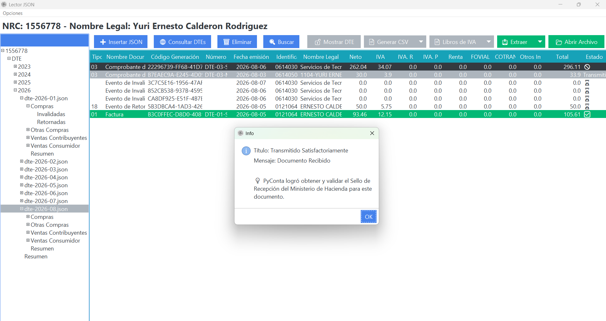
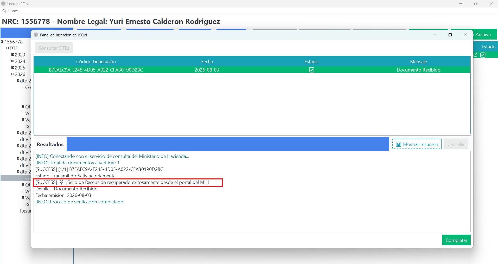

# **Solución a Problemas: DTE Sin Sello de Recepción**

Cuando un DTE ingresa a PyConta sin el **Sello de Recepción** oficial del Ministerio de Hacienda, el sistema te permite identificar la causa y recuperarlo automáticamente.

---

## **¿Por qué un DTE puede llegar sin sello?**

1. **Emisión en Contingencia**: El emisor del DTE experimentó problemas temporales de conexión con el Ministerio de Hacienda al facturar y envió el documento al cliente antes de que Hacienda generara el sello de recepción.
2. **Envío Inmediato sin Esperar Validación**: Algunos sistemas de facturación remiten el correo al cliente antes de recibir la confirmación de procesamiento de Hacienda.
3. **Documento No Procesado por Hacienda**: El DTE no llegó a ser recibido o fue rechazado por la autoridad tributaria.

---

## **Cómo Recuperar el Sello Oficial con PyConta**

PyConta integra la función de **Consulta en Hacienda**, la cual se comunica directamente con el servicio de consulta del Ministerio de Hacienda para solicitar el estado oficial y el sello asignado:

### Pasos para recuperar el sello:
1. Dirígete al **Lector JSON** y ubica el DTE sin sello en la tabla.
2. Ejecuta la verificación mediante las modalidades detalladas en [Consulta en Hacienda](../flujos/consulta-hacienda.md):
   - **Consulta Individual**: Haz clic derecho sobre la fila del DTE y selecciona **Consultar DTE**. Al procesarse con éxito, se mostrará el cuadro informativo confirmando la obtención y validación del sello de recepción.

     { align=center }

   - **Consulta Masiva o Selección Múltiple**: Si tienes varios documentos pendientes, selecciónalos o presiona el botón **Consultar DTEs**. La consola del proceso indicará en tiempo real la recuperación exitosa del sello para cada documento verificado.

     { align=center }

3. Al concluir la consulta exitosa ante Hacienda:
   - El sistema descarga e incorpora el **Sello de Recepción oficial**.
   - Se actualiza automáticamente la metadata en el archivo `.json` del DTE.

---

## **¿Qué hacer si Hacienda responde que el DTE no existe o fue rechazado?**

Si la consulta oficial indica que el documento no cuenta con registro válido en Hacienda:
- Contacta al emisor o proveedor para que reenvíe el DTE debidamente firmado y recibido por Hacienda.
- Puedes apoyarte en nuestro equipo mediante [Soporte con PIN](../suscripcion-y-soporte/solicitar-soporte-con-pin.md).
