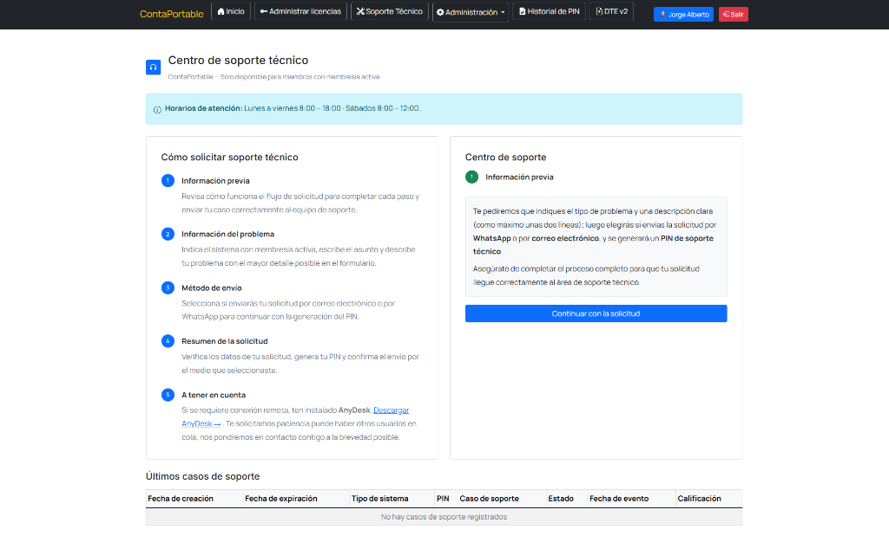

# **Soporte con PIN**

El servicio de soporte técnico para usuarios con membresía activa se gestiona de forma centralizada a través del portal de clientes de **ContaPortable**. Este mecanismo garantiza una atención ordenada y prioritaria mediante la emisión de un **PIN de soporte técnico** único para cada consulta o incidencia.

---

## **Requisitos Previos**

Para poder generar una solicitud de soporte técnico mediante PIN, asegúrate de cumplir con los siguientes requisitos:

- **Membresía activa:** Contar con una suscripción o membresía vigente vinculada a tu cuenta o correo de compra.
- **Acceso al portal:** Disponer de credenciales activas para iniciar sesión en la plataforma VIP.
- **Detalle de la incidencia:** Tener claro el sistema con problema, asunto, descripción puntual del error y capturas de pantalla o evidencias preparadas.
- **Herramienta de conexión remota:** Si tu caso requiere intervención directa de un técnico, ten instalado previamente [AnyDesk](https://anydesk.com/es/downloads).

---

## **Horarios de Atención**

El equipo de soporte técnico brinda atención en los siguientes horarios:

- **Lunes a viernes:** 8:00 – 18:00
- **Sábados:** 8:00 – 12:00

---

## **Acceso al Centro de Soporte Técnico**

Para iniciar tu solicitud, sigue estos pasos:

1. Ingresa a la plataforma e inicia sesión con tu usuario y contraseña:
   [Membresía | Home](https://www.contaportable.com/vip/public/home)
2. En la barra de navegación superior, haz clic en la opción **Soporte Técnico** o accede directamente a:
   [Membresía | Soporte Técnico](https://www.contaportable.com/vip/public/membresia/soporteTecnico)
3. Sigue las indicaciones del asistente en la página para completar el formulario, generar tu PIN y remitir la solicitud por el canal de tu preferencia (WhatsApp o correo electrónico).

{ align=center }

---

## **Historial y Seguimiento de Casos**

En la parte inferior de la página de soporte dispones de la sección **Últimos casos de soporte**, donde puedes consultar el estado y trazabilidad de tus tickets:

| Campo | Descripción |
| :--- | :--- |
| **Fecha de creación** | Momento exacto en que se generó la solicitud en el portal. |
| **Fecha de expiración** | Límite de vigencia asignado al PIN de soporte generado. |
| **Tipo de sistema** | Sistema o producto asociado al ticket. |
| **PIN** | Código numérico asignado a tu caso. |
| **Caso de soporte** | Identificador o resumen del requerimiento. |
| **Estado** | Estado actual de atención (Pendiente, En proceso, Finalizado). |
| **Fecha de evento** | Registro de última actualización o atención brindada. |
| **Calificación** | Evaluación del servicio recibido tras concluir la asistencia. |

---

!!! info "Canal de Contacto Alternativo"
    Si presentas inconvenientes para iniciar sesión en el portal o acceder a tu cuenta VIP, puedes contactar al equipo de soporte a través del correo oficial: **soporte@contaportable.com**.
